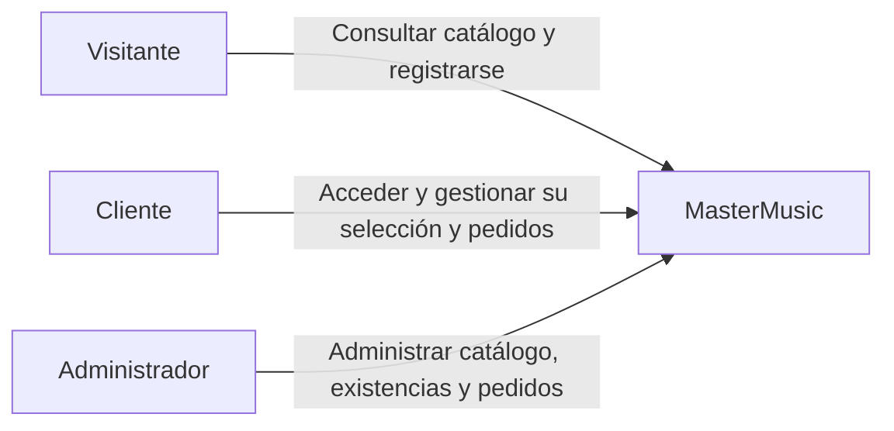
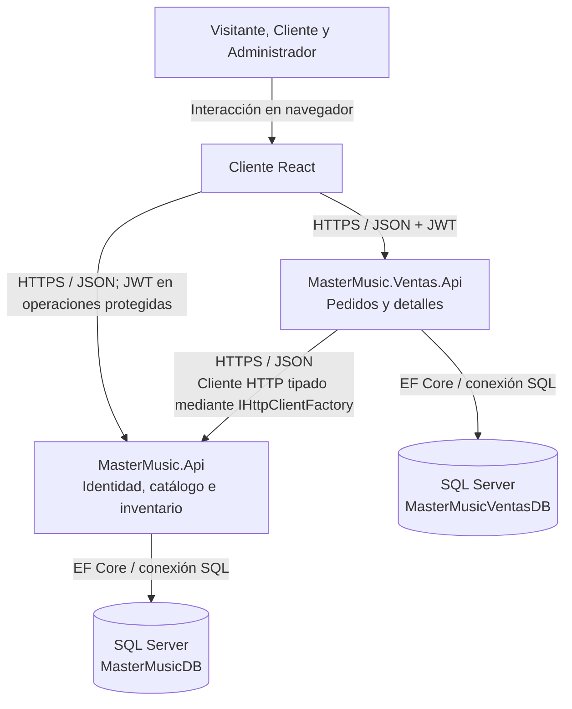

# Arquitectura de MasterMusic para el Trabajo 3

Estado: diseño propuesto para revisión del equipo; no representa funcionalidades ya implementadas.

Este diseño amplía la API existente con una API de pedidos y un cliente React. Cubre el diagrama de arquitectura solicitado en el Hito 2 y orienta la implementación de los RF-01 a RF-22. Conserva los controladores, EF Core, SQL Server, JWT y roles del proyecto.

## Contexto

MasterMusic sirve a visitantes, clientes y administradores. Audiomusica es una fuente documental del levantamiento, no un sistema conectado. Los pagos y la entrega se realizan fuera de la aplicación.

## Contenedores y comunicación

React consume ambas APIs. La API de pedidos consulta y solicita movimientos de inventario a la primera API mediante HTTP. Cada API accede únicamente a su propia base de datos; no se crean claves foráneas entre bases. Las dos bases pueden residir en la misma instancia SQL Server Express.

## Responsabilidades

| Componente | Responsabilidad |
|---|---|
| MasterMusic.Api | Registro y login, emisión de JWT, roles, catálogo público de instrumentos activos, administración de instrumentos, categorías, marcas y movimientos de existencias. |
| MasterMusic.Ventas.Api | Validación de JWT, registro y consulta de pedidos, autorización por propietario o administrador, confirmación y cancelación; detalles con nombre y precio históricos. |
| React | Acceso y cierre de sesión, catálogo, selección y resumen, pantallas administrativas y de pedidos; indicadores de carga, validaciones, errores y sesión expirada. |
| MasterMusicDB | Entidades existentes y registros persistentes necesarios para controlar movimientos de inventario. |
| MasterMusicVentasDB | Pedidos, detalles y registro del progreso de operaciones recuperables. |

El nombre MasterMusic.Ventas.Api se conserva de la propuesta previa; su función en esta versión es gestionar pedidos, no acreditar pagos. Las tablas antiguas Venta, DetalleVenta y Resena no se eliminan automáticamente ni se consideran implementación de los pedidos nuevos.

## Seguridad

- La primera API emite el JWT. Ambas validan firma, emisor, audiencia y vigencia.
- Cliente consulta únicamente sus pedidos. El identificador del cliente se obtiene del JWT, no de un campo libre enviado por React.
- Administrador mantiene el catálogo y gestiona los pedidos.
- Las llamadas internas que descuentan o devuelven stock necesitan autorización de servicio específica. El JWT del cliente por sí solo no autorizará a invocar movimientos internos directamente.
- Para el entorno académico se propone una credencial de servicio en una cabecera, obtenida por ambas APIs desde variables de entorno y nunca enviada a React. El contrato deberá definir esa cabecera y sus respuestas de error. Esta credencial es adicional a los controles de usuario aplicables.
- Llaves, credenciales y conexiones se configuran fuera del repositorio. CORS permitirá únicamente el origen configurado del cliente.

## Pedidos, inventario y fallos

No hay una transacción única que abarque ambas APIs. Se propone persistir el progreso y poder recuperar las operaciones, usando transacciones locales en cada base.

1. React genera una clave de operación para el envío y la reutiliza si reintenta ese mismo envío. La API de pedidos la asocia al cliente y al contenido; rechaza reutilizarla para un pedido distinto.
2. La API de pedidos guarda la solicitud como operación en proceso, sin presentarla todavía como pedido aceptado.
3. La primera API valida instrumentos activos, cantidades, precios esperados y stock. En una transacción local descuenta todas las cantidades y registra el resultado con la clave de operación. Si falla una validación, no descuenta ninguna.
4. Las actualizaciones de stock deben ser condicionales y seguras ante concurrencia. No basta con leer el stock y sobrescribirlo después. Un índice único para la operación impide aplicar el mismo descuento dos veces.
5. La respuesta incluye los nombres y precios aplicados. La API de pedidos guarda esos datos históricos y finaliza el pedido como Pendiente. Si el precio cambió frente al resumen, la operación no se acepta y el cliente debe revisar el nuevo precio.
6. Ante un timeout, el resultado es incierto: se consulta la operación en inventario usando su clave antes de decidir qué hacer. El timeout de cada llamada será de cinco segundos, como propone RNF-06; no se promete que todo el proceso termine en cinco segundos.
7. Si el descuento se completó pero falló el guardado del pedido, la operación persistida permite reanudarlo. Si no puede completarse, debe solicitarse una devolución compensatoria identificable y recuperable. No se considera resuelto un fallo solo porque se lanzó una petición de compensación.
8. Confirmar no modifica stock. Para cancelar, primero se registra la intención y el motivo, excluyendo una confirmación concurrente. Luego se devuelve stock una sola vez y finalmente se marca Cancelado. Si se interrumpe, se consulta y reanuda la misma devolución.

Pendiente, Confirmado y Cancelado son estados del negocio. El progreso técnico de una operación debe almacenarse por separado y mostrarse como procesamiento o recuperación pendiente cuando corresponda, sin afirmar aceptación o cancelación antes de confirmarlas.

Los endpoints, índices y mecanismo concreto para consultar y reanudar operaciones se definirán en los contratos y secuencias antes de programar pedidos. También se debe resolver allí cómo impedir eliminar un instrumento utilizado por pedidos y cómo conservar esa restricción ante concurrencia o indisponibilidad de la otra API. Este documento no da esos problemas por implementados ni probados.

## Ejecución prevista

El entorno inicial será local: React, dos procesos ASP.NET Core y SQL Server Express. No se requiere Docker para este diseño. Los puertos y variables exactos se fijarán en el diagrama de despliegue de acuerdo con la configuración que se implemente.

## Criterio de finalización de la tarea

- Ambos integrantes revisan y comprenden las responsabilidades y la comunicación.
- Se revisan los dos diagramas y se exportan como PNG o SVG para la entrega.
- El archivo fuente y las exportaciones se versionan con la revisión real del equipo.
- Se registran los acuerdos o ajustes; el diseño no se presenta como sistema ya construido.

## Siguiente tarea

Derivar el modelo de clases y entidad-relación de esta arquitectura y de la ERS existente; después diseñar los contratos OpenAPI y las tres secuencias exigidas: login, registro de pedido entre APIs y un flujo de error. No reescribir las historias existentes.
