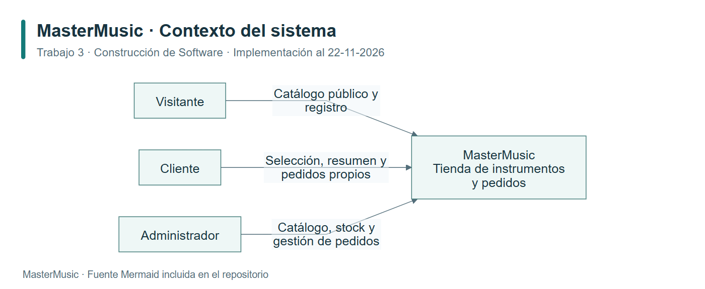
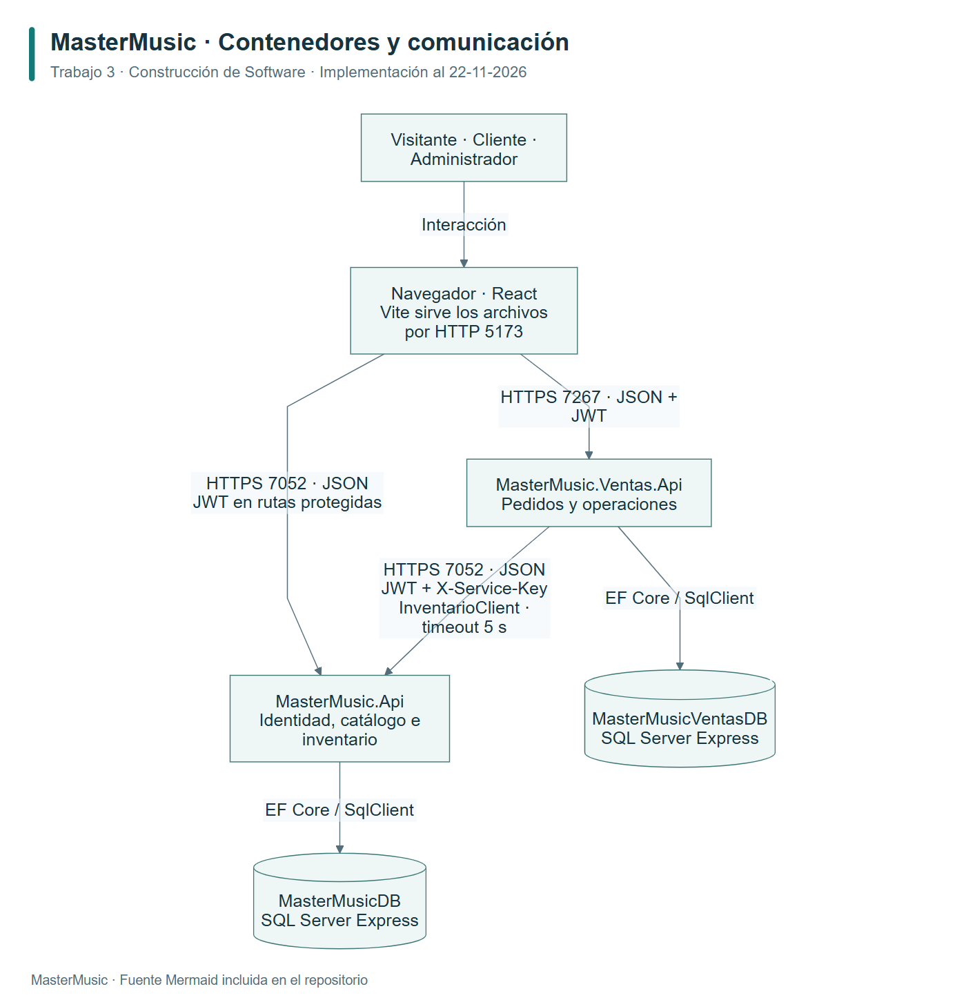

# Arquitectura de MasterMusic

Versión de implementación: 22 de noviembre de 2026. Actualiza el diseño del Hito 2 conforme a las dos APIs y al cliente del Hito 3. Las versiones iniciales se conservan en el historial Git y en la rama docs/semana-2.

## Contexto

[Fuente Mermaid](Diagramas/01-arquitectura-contexto.mmd) · [SVG](Diagramas/01-arquitectura-contexto.svg) · [PNG](Diagramas/01-arquitectura-contexto.png)

MasterMusic permite consultar instrumentos y gestionar solicitudes de compra. Visitante es un estado de acceso anónimo; Cliente y Administrador son los roles autenticados. Los pagos, despachos, reseñas y múltiples sucursales quedan fuera del alcance. Audiomúsica es una fuente del análisis documental, no un servicio conectado.

## Contenedores

[Fuente Mermaid](Diagramas/02-arquitectura-contenedores.mmd) · [SVG](Diagramas/02-arquitectura-contenedores.svg) · [PNG](Diagramas/02-arquitectura-contenedores.png)

React se ejecuta en el navegador y consume las dos APIs. Vite sirve sus archivos en desarrollo. Cada API usa únicamente su contexto EF Core y su propia base; las dos bases residen en la instancia local SQL Server Express. No hay claves foráneas ni consultas SQL cruzadas entre bases.

| Componente | Responsabilidad implementada |
| --- | --- |
| MasterMusic.Api | Registro/login, JWT, catálogo, mantenimiento de instrumentos/categorías/marcas y movimientos de inventario. |
| MasterMusic.Ventas.Api | Pedidos propios y administrativos, confirmación, cancelación y recuperación de operaciones inciertas. |
| MasterMusic.Client | Sesión, catálogo, selección, resumen, pedidos e inventario; estados de carga y errores. |
| MasterMusicDB | Identidad, catálogo, movimientos y tablas heredadas Venta, DetalleVenta y Resena. |
| MasterMusicVentasDB | Pedido, DetallePedido y OperacionPedido. |

## Seguridad e integración

La API de catálogo emite el JWT; ambas APIs validan firma, emisor, audiencia y vencimiento. Los pedidos propios usan el identificador del JWT. La administración exige Administrador. Las rutas internas verifican simultáneamente JWT y X-Service-Key; la clave de servicio proviene de configuración y no se entrega a React.

InventarioClient se registra mediante AddHttpClient y utiliza un timeout de cinco segundos por llamada. React conserva el JWT en memoria; la solicitud pendiente y su clave de reintento se guardan por cuenta para poder retomarla. CORS permite el origen configurado del cliente. Los nombres de variables y puertos están en el [despliegue](Diagrama-despliegue-MasterMusic.md) y en el [README](../README.md).

## Consistencia entre pedidos y stock

1. Ventas guarda una operación EnProceso y su comando antes de llamar a inventario.
2. La recuperación abre una transacción de Ventas y serializa la operación con un bloqueo de aplicación SQL. Consulta el movimiento original; si no existe, solicita el descuento con el mismo identificador.
3. Inventario bloquea la operación, el pedido y los instrumentos; valida todas las líneas y confirma conjuntamente el stock y el movimiento. Cada pedido admite un único descuento.
4. Ventas verifica la respuesta y guarda pedido, detalles históricos y operación Completada en su transacción local.
5. Un resultado incierto conserva EnProceso y devuelve 202. La consulta y recuperación reutilizan los identificadores originales.
6. Confirmar cambia el pedido sin otro descuento. Cancelar persiste la intención y solo marca Cancelado tras verificar una devolución única.

Hay transacciones locales independientes. La transacción de recuperación de Ventas puede permanecer abierta durante el HTTP; no es una transacción distribuida. Esta elección serializa reintentos, pero puede prolongar bloqueos si inventario demora.

La implementación no ejecuta la compensación automática de altas propuesta inicialmente. Conserva y recupera la operación original. Esta limitación está documentada en [la comparación de contratos](Contratos/Comparacion-diseno-implementacion.md).

## Trazabilidad y fuentes

RF-01 a RF-22: [matriz](Matriz-trazabilidad-MasterMusic.md). Decisiones: [dos APIs](ADR/ADR-001-dos-apis-y-bases-independientes.md), [seguridad](ADR/ADR-002-jwt-roles-y-clave-interna.md) e [idempotencia](ADR/ADR-003-idempotencia-y-stock.md).

La revisión se contrastó con Program.cs de ambas APIs, InventarioClient, CreacionPedidosService, CambiosPedidosService y el cliente React. Las fuentes Mermaid y sus exportaciones acompañan este archivo.
