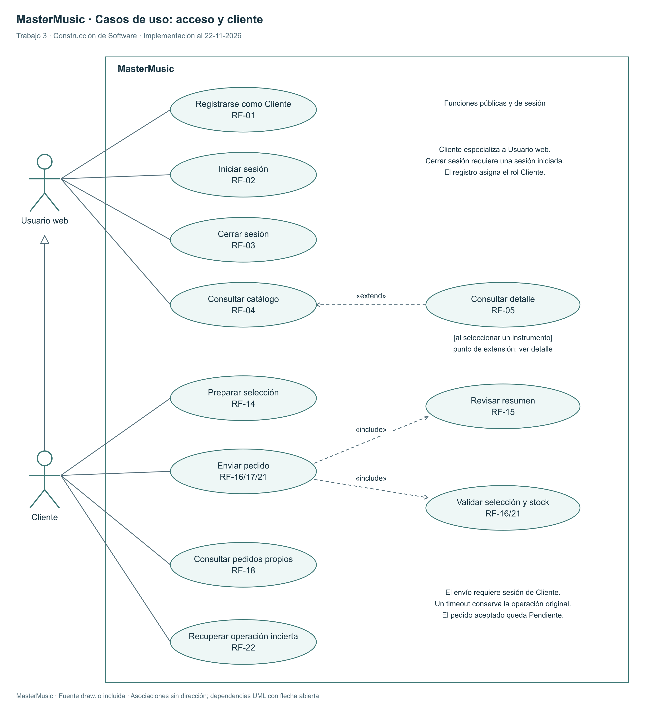
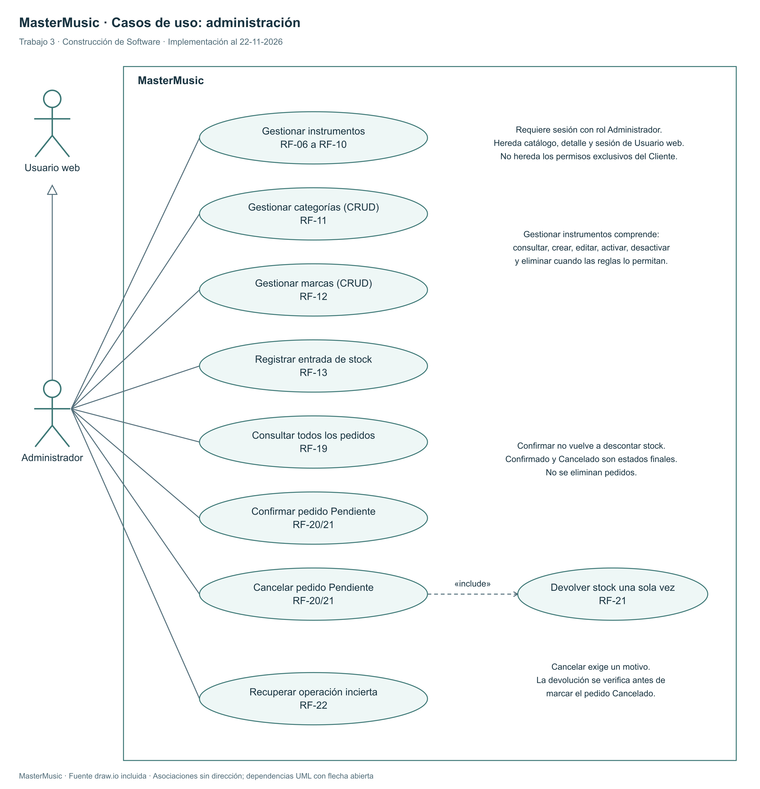

# Casos de uso UML de MasterMusic

Versión de implementación: 22 de noviembre de 2026. Las dos vistas representan el mismo sistema, con límite explícito, actores externos, asociaciones y relaciones UML. Los diagramas cubren los requisitos RF-01 a RF-22 de la ERS.

## Actores y permisos

Usuario web representa a cualquier persona que utiliza el cliente: puede consultar el catálogo y el detalle; puede registrarse e iniciar sesión. Cerrar sesión requiere haber iniciado una. Cliente y Administrador especializan a Usuario web y heredan sus capacidades comunes. Los roles Cliente y Administrador son distintos: el Administrador no hereda el permiso de crear pedidos como Cliente.

El inicio de sesión es un caso de uso independiente. Para las operaciones protegidas, tener una sesión vigente es una precondición; no se obliga a volver a iniciar sesión en cada operación. El registro público siempre crea una cuenta Cliente.

## Acceso y cliente

[Fuente draw.io](Diagramas/11-casos-uso-acceso-cliente.drawio) · [SVG](Diagramas/11-casos-uso-acceso-cliente.svg) · [PNG](Diagramas/11-casos-uso-acceso-cliente.png)

Enviar pedido incluye revisar el resumen y validar la selección y el stock. Estos pasos son obligatorios: el usuario revisa los importes, y el servidor comprueba cantidades, actividad, disponibilidad y precios antes de aceptar. El detalle extiende opcionalmente la consulta del catálogo, en el punto «ver detalle», cuando se selecciona un instrumento.

Recuperar operación incierta es una acción posterior e independiente, disponible si quedó una operación sin resultado definitivo. Reutiliza la identidad de esa operación. El cliente solo consulta sus propios pedidos y operaciones; estas restricciones también se aplican en la API.

## Administración

[Fuente draw.io](Diagramas/12-casos-uso-administracion.drawio) · [SVG](Diagramas/12-casos-uso-administracion.svg) · [PNG](Diagramas/12-casos-uso-administracion.png)

Gestionar instrumentos agrupa las operaciones de consulta, creación, edición, activación, desactivación y eliminación. Cada operación se ejecuta por separado; no se usa «include» entre ellas porque una consulta no obliga a crear o eliminar. La eliminación exige stock cero y ausencia de referencias. Categorías y marcas ofrecen CRUD, con rechazo de eliminación si están en uso.

Confirmar y cancelar solo parten de Pendiente. Cancelar incluye devolver el stock una sola vez y exige motivo; la transición se guarda después de verificar la devolución. Confirmar no descuenta otra vez. Si una llamada queda incierta, el administrador puede recuperar su operación; esto no permite modificar pedidos que ya estén Confirmados o Cancelados.

## Trazabilidad

| Casos de uso | Requisitos | Historias |
| --- | --- | --- |
| Registro, inicio y cierre de sesión | RF-01/02/03 | HU-01/02/03 |
| Catálogo y detalle | RF-04/05 | HU-04 |
| Gestión de instrumentos | RF-06 a RF-10 | HU-05 a HU-09 |
| Categorías, marcas y entrada de stock | RF-11/12/13 | HU-10/11/12 |
| Selección y resumen | RF-14/15 | HU-13/14 |
| Enviar pedido y validar stock | RF-16/17/21 | HU-15 |
| Pedidos propios | RF-18 | HU-16 |
| Consulta administrativa de pedidos | RF-19 | HU-17 |
| Confirmar y cancelar, con devolución | RF-20/21 | HU-18 |
| Recuperación de operaciones inciertas | RF-22 | HU-15/18 |

La [matriz de trazabilidad](Matriz-trazabilidad-MasterMusic.md) detalla los endpoints y pruebas asociados. Las reglas se contrastaron con las dos APIs, el cliente React y la ERS. Pagos, despachos y reseñas no forman parte del alcance activo.

## Fuente de semana 1 y actualización

Se conserva el [PNG original de semana 1](Diagrama%20CasoDeUso.drawio.png). Su fuente editable, que estaba incrustada en ese PNG, se extrajo sin modificarlo: [draw.io original](Diagramas/00-casos-uso-semana1-original.drawio).

Las vistas actuales añaden los casos implementados de inventario, confirmación, cancelación y recuperación, y hacen explícita la notación UML. No sustituyen ni reescriben el historial de semana 1.

La línea continua sin flecha asocia un actor con un caso de uso. El triángulo hueco apunta al actor general. La dependencia «include» apunta al comportamiento obligatorio incluido; «extend» apunta al caso base extendido bajo una condición.
