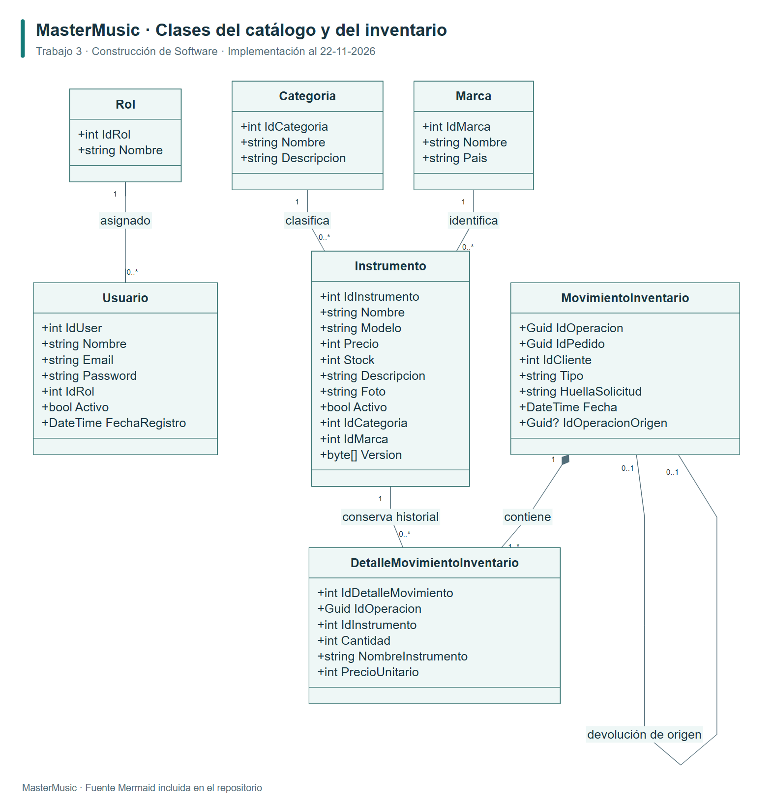
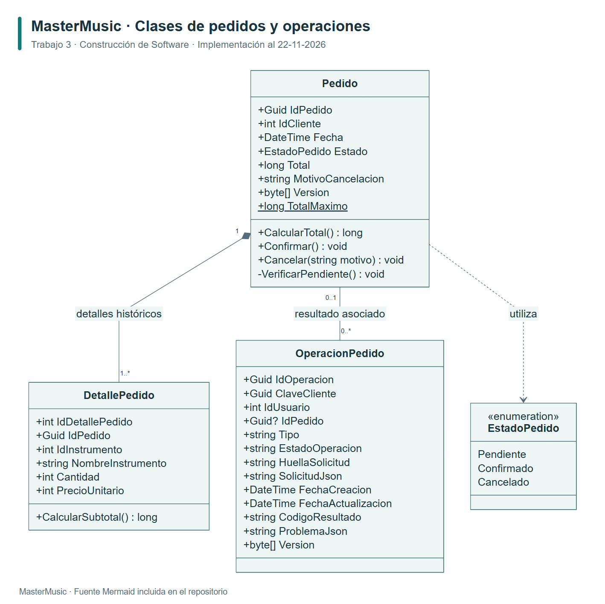

# Diagrama UML de clases de MasterMusic

Versión de implementación: 22 de noviembre de 2026. Se muestran las entidades del dominio activo y sus operaciones reales. Las dos vistas forman el mismo modelo; los servicios coordinan las transacciones y la comunicación.

## Identidad, catálogo e inventario — MasterMusic.Api

[Fuente Mermaid](Diagramas/03-clases-catalogo.mmd) · [SVG](Diagramas/03-clases-catalogo.svg) · [PNG](Diagramas/03-clases-catalogo.png)

Usuario.Password contiene un hash BCrypt y nunca se publica en las respuestas de acceso. Las propiedades de texto opcionales se muestran como string para facilitar la lectura: Descripcion, Modelo, Foto y Pais pueden ser nulas. Version es el token rowversion de SQL Server.

Instrumento es una entidad de datos y no declara métodos Activar, DescontarStock o DevolverStock. El código realiza esas operaciones en InstrumentosAdminController, MovimientosController y el repositorio. El diagrama inicial proponía métodos de entidad; esta vista muestra la distribución implementada.

MovimientoInventario registra Descuento o Devolucion. Un descuento puede tener como máximo una devolución; una devolución referencia su origen. Cada movimiento aceptado contiene uno o más detalles históricos.

## Pedidos — MasterMusic.Ventas.Api

[Fuente Mermaid](Diagramas/04-clases-pedidos.mmd) · [SVG](Diagramas/04-clases-pedidos.svg) · [PNG](Diagramas/04-clases-pedidos.png)

Pedido y DetallePedido exponen propiedades con setters privados. Sus constructores validan identificadores, cantidades, precios y pertenencia; Pedido exige al menos un detalle sin instrumentos repetidos. TotalMaximo es la constante 9007199254740991. CalcularSubtotal convierte a long antes de multiplicar; CalcularTotal controla el límite al sumar.

Confirmar y Cancelar solo permiten partir de Pendiente. El servicio llama a Cancelar después de verificar la devolución; el método no realiza una llamada HTTP por sí mismo.

OperacionPedido guarda la intención y el resultado técnico. Los estados que generan los servicios son EnProceso, Completada y Rechazada; no son estados de Pedido. IdPedido puede ser nulo antes de guardar un alta, cuyo identificador previsto permanece en SolicitudJson. ProblemaJson conserva el rechazo sin almacenar credenciales.

## Relaciones lógicas entre APIs

| Referencia | Interpretación |
| --- | --- |
| Pedido.IdCliente → Usuario.IdUser | Un Cliente puede tener cero o más pedidos; cada pedido pertenece a una cuenta. |
| DetallePedido.IdInstrumento → Instrumento.IdInstrumento | La línea identifica un instrumento y conserva nombre y precio históricos. |
| MovimientoInventario.IdPedido → Pedido.IdPedido | Identificador previsto o existente, usado para impedir descuentos duplicados. |
| OperacionPedido.IdUsuario → Usuario.IdUser | Actor Cliente o Administrador, tomado del JWT. |

Estas son referencias de negocio por identificador, sin FK ni navegación EF Core hacia otra base. Las relaciones dibujadas dentro de cada vista pertenecen al modelo local. La composición de detalles expresa dependencia de la cabecera; no implica que el sistema ofrezca eliminar pedidos.

## Coordinación y alcance

CreacionPedidosService.CrearAsync y RecuperarAsync coordinan el alta; CambiosPedidosService.EjecutarAsync y RecuperarAsync coordinan confirmaciones y cancelaciones. InventarioClient ofrece ConsultarAsync, DescontarAsync y DevolverAsync. Los bloqueos, índices y transacciones se describen en el [modelo ER](Modelo-entidad-relacion-MasterMusic.md).

Las clases heredadas Venta, DetalleVenta y Resena permanecen en la primera API, fuera del flujo activo de pedidos; sus tablas se muestran en el modelo ER. No hay entidad Carrito: la selección pertenece a React.

Requisitos: identidad RF-01/02; catálogo RF-04 a RF-13; selección RF-14/15; pedidos RF-16 a RF-22. La [matriz](Matriz-trazabilidad-MasterMusic.md) enlaza cada requisito con sus pruebas y endpoints.
