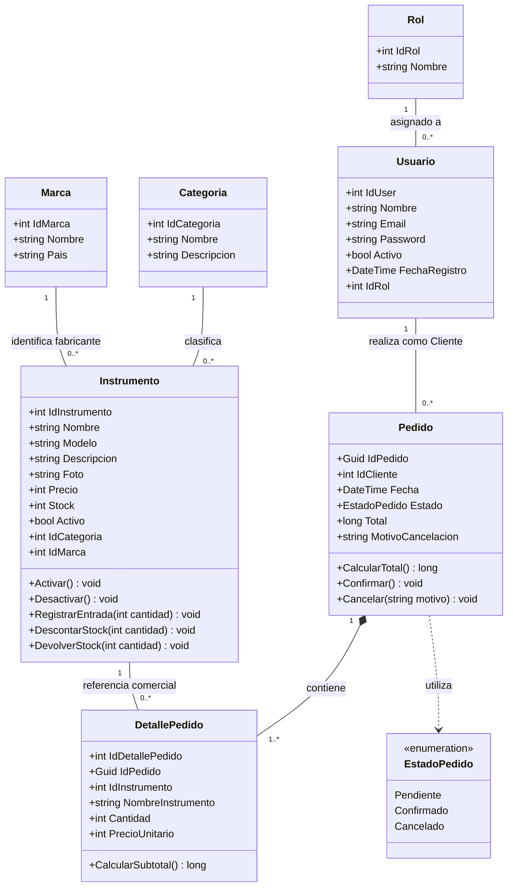

# Diagrama UML de clases de MasterMusic

Diseño del dominio para el Trabajo 3. Incluye las entidades existentes y las clases de pedidos que se implementarán en la segunda API.

Este diagrama cubre las clases del dominio activo de la ERS: identidad, catálogo, inventario y pedidos. Reutiliza las entidades existentes de la primera API y propone las clases de la segunda API. Corresponde al Hito 2 y al criterio de modelado de la pauta.

## Interpretación y pertenencia a cada API

| API | Clases del dominio |
|---|---|
| MasterMusic.Api | Rol, Usuario, Categoria, Marca e Instrumento. |
| MasterMusic.Ventas.Api | Pedido, DetallePedido y EstadoPedido. |

Cada usuario tiene un rol; un rol puede estar asignado a varios usuarios. Cada instrumento pertenece a una categoría y una marca. Un usuario con rol Cliente puede realizar varios pedidos. Cada pedido aceptado contiene uno o más detalles, y cada detalle pertenece a un solo pedido.

Las asociaciones Usuario–Pedido e Instrumento–DetallePedido son relaciones del negocio entre APIs. Se almacenan identificadores externos, no claves foráneas entre bases ni navegaciones EF Core hacia el contexto de otra API. Los detalles conservan nombre y precio históricos: consultarlos no depende de obtener esos datos actuales del catálogo.

La composición Pedido–DetallePedido indica que un detalle no tiene sentido fuera de su pedido. No prescribe borrado en cascada: la aplicación no permitirá eliminar pedidos finalizados.

## Atributos y operaciones

- Usuario.Password conserva el nombre actual de la propiedad, pero almacena exclusivamente un hash BCrypt. No se expone en los DTO de respuesta ni en los registros.
- Modelo, Descripcion y Foto de Instrumento, Descripcion de Categoria y Pais de Marca pueden carecer de información. La notación simplificada del diagrama no muestra la nulabilidad de C#.
- MotivoCancelacion es opcional mientras el pedido no esté cancelado; para cancelar debe contener texto no vacío ni compuesto solo por espacios.
- Precio y PrecioUnitario son enteros positivos en pesos chilenos, sin decimales. Se propone long para subtotales y total para evitar desbordamientos al multiplicar o sumar valores int; el cálculo debe convertir a long antes de multiplicar y validar sus límites.
- Se propone Guid para IdPedido, generado por la API de pedidos. Este identificador no sustituye la clave de idempotencia de cada operación.
- Los métodos muestran comportamientos relevantes del dominio propuesto. Las entidades actuales de Instrumento aún no implementan esos métodos. En la construcción podrá organizarse la lógica en métodos de entidad o servicios sencillos, manteniendo actualizado este diagrama.
- CalcularSubtotal utiliza Cantidad por PrecioUnitario; CalcularTotal suma los subtotales del pedido. Los valores aceptados provienen del servidor.
- RegistrarEntrada exige una cantidad positiva. DescontarStock no puede producir stock negativo. DevolverStock debe aplicarse una sola vez por cancelación.
- Confirmar y Cancelar solo permiten transiciones desde Pendiente. Confirmado y Cancelado son estados finales en esta versión. Confirmar no vuelve a descontar existencias.

## Reglas que requieren coordinación

El diagrama representa el pedido aceptado. Una solicitud todavía en procesamiento o recuperación no debe presentarse como un pedido aceptado en estado Pendiente.

Los métodos de stock y cancelación no garantizan por sí solos concurrencia segura ni consistencia entre APIs. Los servicios de aplicación deberán coordinar transacciones locales, actualizaciones condicionales, operaciones persistentes identificadas y recuperación de resultados inciertos. Cancelar expresa el resultado de negocio; no debe marcarse Cancelado antes de confirmar la devolución del stock.

Los registros técnicos de idempotencia y recuperación se detallarán en el modelo de datos y los contratos. No se inventa aquí una transacción distribuida. Se aplican RF-13, RF-21 y RF-22.

La eliminación de un instrumento requiere stock cero y ausencia de pedidos asociados (RF-10). La relación con pedidos deberá comprobarse de forma segura entre APIs; no habrá una clave foránea compartida que resuelva esa regla automáticamente. La activación o desactivación conserva el historial.

## Entidades existentes fuera de este diseño activo

Venta, DetalleVenta y Resena existen en el proyecto del Trabajo 2 y se conservan. No se consideran implementación del nuevo flujo de pedidos ni se eliminan con este documento. Venta incluye conceptos como tipo de pago y vendedor que no deben trasladarse automáticamente al nuevo pedido. El modelo ER de la base existente debe seguir mostrando esas tablas mientras existan físicamente.

## Trazabilidad

| Elementos | Requisitos de la ERS |
|---|---|
| Usuario y Rol | RF-01, RF-02 y autorización por roles. RF-03 corresponde al cliente web. |
| Instrumento, Categoria y Marca | RF-04 a RF-13. |
| Pedido, DetallePedido y EstadoPedido | RF-16 a RF-22. |
| Selección y resumen antes del envío | RF-14 y RF-15: estado del cliente React; no se propone una tabla Carrito. |

