# Diagrama de despliegue — MasterMusic

## Alcance

Describe la configuración local del Trabajo 3 utilizada para la demostración: cliente React, dos APIs ASP.NET Core en procesos independientes y dos bases en SQL Server Express. Se contrastó con el código de la rama `feat/api-pedidos` hasta el commit `12f29ba`, el 22 de noviembre de 2026.

El documento cumple el contenido solicitado para el diagrama de despliegue en Trabajo3-CS: nodos, puertos, dependencias y variables de entorno. La imagen es un mapa de ejecución; las capturas del sistema y los reportes de pruebas documentan los resultados de funcionamiento.

## Diagrama

```mermaid
flowchart TB
    subgraph PC["Equipo Windows — entorno local Development"]
        subgraph NAVEGADOR["Navegador"]
            CLIENTE["Cliente React 19<br/>Catálogo, pedidos e inventario"]
        end
        subgraph NODE["Proceso Node.js / Vite"]
            VITE["Archivos del cliente<br/>HTTP localhost:5173"]
        end
        subgraph NET1["Proceso ASP.NET Core / Kestrel"]
            API1["MasterMusic.Api<br/>HTTPS localhost:7052<br/>Catálogo, usuarios e inventario"]
        end
        subgraph NET2["Proceso ASP.NET Core / Kestrel independiente"]
            API2["MasterMusic.Ventas.Api<br/>HTTPS localhost:7267<br/>Pedidos y operaciones"]
        end
        subgraph SQL["Servicio SQL Server Express — instancia SQLEXPRESS"]
            DB1[("MasterMusicDB")]
            DB2[("MasterMusicVentasDB")]
        end
    end
    VITE -->|"HTTP 5173 · HTML, CSS y JavaScript"| CLIENTE
    CLIENTE -->|"HTTPS 7052 · JSON · JWT cuando corresponda"| API1
    CLIENTE -->|"HTTPS 7267 · JSON y JWT"| API2
    API2 -->|"HTTPS 7052 · cliente HTTP tipado · 5 s · JWT + X-Service-Key"| API1
    API1 -->|"EF Core / SqlClient · autenticación Windows"| DB1
    API2 -->|"EF Core / SqlClient · autenticación Windows"| DB2
    classDef cliente fill:#e8f3f2,stroke:#147a78,color:#15313b;
    classDef servicio fill:#eff5fb,stroke:#376b8f,color:#15313b;
    classDef datos fill:#fff4e9,stroke:#b76826,color:#15313b;
    class CLIENTE,VITE cliente;
    class API1,API2 servicio;
    class DB1,DB2 datos;
```



Archivos del mismo diagrama:

- [Fuente Mermaid](Diagrama-despliegue-MasterMusic.mmd).
- [Versión vectorial SVG](Diagrama-despliegue-MasterMusic.svg).
- [Imagen PNG para el informe](Diagrama-despliegue-MasterMusic.png).

Los grupos representan procesos y nodos locales. Vite entrega los archivos, y React se ejecuta en el navegador. Cada API abre conexiones únicamente con su base de datos. La comunicación entre APIs se realiza desde la API de pedidos hacia la API de catálogo mediante el cliente HTTP tipado `InventarioClient`.

## Direcciones y puertos

| Componente | Dirección de desarrollo | Función |
|---|---|---|
| React / Vite | http://localhost:5173/ | Cliente web; Vite usa puerto estricto. |
| API de catálogo | https://localhost:7052 | Usuarios, autenticación, instrumentos, categorías, marcas y movimientos de inventario. |
| Swagger de catálogo | https://localhost:7052/swagger | Documentación interactiva de API 1. |
| OpenAPI de catálogo | https://localhost:7052/swagger/v1/swagger.json | Documento generado por API 1. |
| API de pedidos | https://localhost:7267 | Pedidos de clientes, gestión administrativa y recuperación de operaciones. |
| Swagger de pedidos | https://localhost:7267/swagger | Documentación interactiva de API 2. |
| OpenAPI de pedidos | https://localhost:7267/openapi/v1.json | Documento generado por API 2. |
| API de catálogo, escucha HTTP auxiliar | http://localhost:5169 | Declarada junto a HTTPS en su perfil de inicio. |
| API de pedidos, escucha HTTP auxiliar | http://localhost:5033 | Declarada junto a HTTPS en su perfil de inicio. |
| SQL Server Express | Instancia local `.\SQLEXPRESS` | Aloja `MasterMusicDB` y `MasterMusicVentasDB`. |

El navegador y el cliente HTTP interno utilizan las direcciones HTTPS de las APIs. La conexión SQL utiliza SqlClient y autenticación integrada de Windows; el puerto TCP de una instancia nombrada depende de su configuración y no se presupone 1433.

## Dependencias

| Componente | Dependencia verificada en el proyecto |
|---|---|
| APIs | .NET 10 y ASP.NET Core con controladores; proyectos `MasterMusic.Api` y `MasterMusic.Ventas.Api`. |
| Persistencia | EF Core SQL Server 10.0.13 y migraciones independientes por contexto. |
| Cliente | React 19.3.1, Vite 8.3.8 y Node.js 24.22.3 utilizado en las verificaciones. Las dependencias se fijan en `package-lock.json`. |
| Datos | Servicio SQL Server Express disponible y permisos del usuario Windows sobre ambas bases. |
| HTTPS | Certificado de desarrollo confiable para el navegador y para el proceso .NET que llama al catálogo. |
| Documentación de APIs | Swagger en ambas APIs, disponible en el entorno `Development`. |

## Variables de configuración

La tabla enumera los nombres leídos por el sistema; no contiene contraseñas, claves ni valores de cadenas de conexión.

| Variable de entorno | Consumidor | Uso |
|---|---|---|
| `ASPNETCORE_ENVIRONMENT` | Ambas APIs | Selecciona el entorno; los perfiles locales establecen Development. |
| `ConnectionStrings__MasterMusic` | API de catálogo | Conexión de `MasterMusicContext` con la base de catálogo. |
| `ConnectionStrings__MasterMusicVentas` | API de pedidos | Conexión de `MasterMusicVentasContext` con la base de pedidos. |
| `Jwt__Key` | Ambas APIs | Clave simétrica para firmar y validar los tokens. Debe coincidir en ambas APIs. |
| `Jwt__Issuer` | Ambas APIs | Emisor aceptado; debe coincidir con el del token emitido. |
| `Jwt__Audience` | Ambas APIs | Audiencia aceptada; debe coincidir con la del token emitido. |
| `Jwt__ExpireMinutes` | API de catálogo | Duración del JWT emitido. |
| `Admin__Email` | API de catálogo | Identificador de la cuenta administradora inicial. |
| `Admin__Password` | API de catálogo | Contraseña de creación de la cuenta administradora inicial. |
| `Cors__AllowedOrigins__0` | Ambas APIs | Primer origen permitido del cliente; pueden agregarse índices consecutivos. |
| `Inventario__BaseUrl` | API de pedidos | Dirección HTTPS de la API de catálogo. |
| `Inventario__ServiceKey` | Ambas APIs | Secreto compartido enviado y verificado en la cabecera interna `X-Service-Key`. |
| `VITE_CATALOGO_URL` | Vite / React | Dirección pública de la API de catálogo. |
| `VITE_PEDIDOS_URL` | Vite / React | Dirección pública de la API de pedidos. |

En `Development`, si no se configura la lista CORS, ambas APIs permiten el origen local http://localhost:5173. El tiempo límite del cliente HTTP interno está fijado en cinco segundos en `MasterMusic.Ventas.Api/Program.cs`; no existe una variable de configuración para modificarlo en esta versión.

Las variables `VITE_` se incorporan al cliente y contienen únicamente direcciones públicas. Las claves JWT, las credenciales del administrador, la clave interna y las conexiones SQL pertenecen a la configuración de los procesos del servidor.

ASP.NET Core toma las variables del entorno del proceso. Un archivo `.env` del cliente no configura las APIs. Las variables establecidas mediante `$env:` en PowerShell duran solamente en esa sesión; deben volver a cargarse al abrir otra ventana o después de reiniciar el equipo. Cambiar la variable de contraseña inicial no modifica una cuenta administradora que ya exista en la base.

## Inicio del sistema

Antes del arranque, el servicio SQL debe estar disponible, las variables deben estar cargadas y las migraciones de cada contexto aplicadas. Los siguientes comandos se ejecutan desde la raíz del repositorio, en ventanas independientes.

**Ventana 1 — catálogo:**

```powershell
dotnet run --project .\MasterMusic.Api\MasterMusic.Api.csproj --launch-profile https
```

**Ventana 2 — pedidos:**

```powershell
dotnet run --project .\MasterMusic.Ventas.Api\MasterMusic.Ventas.Api.csproj --launch-profile https
```

**Ventana 3 — cliente:**

```powershell
cd .\MasterMusic.Client
npm.cmd ci
npm.cmd run dev
```

La instalación mediante `npm.cmd ci` se realiza al preparar el cliente o al actualizar sus dependencias. Abrir http://localhost:5173/ cuando los tres procesos estén escuchando. Las ventanas permanecen abiertas durante la demostración.

## Comunicación y consistencia

1. El cliente obtiene el JWT mediante el inicio de sesión en API 1 y lo adjunta a las solicitudes protegidas.
2. Al crear un pedido, API 2 registra una operación durable y llama a API 1 por HTTPS con el JWT y la clave interna.
3. API 1 valida existencias y precios, aplica el movimiento de inventario y conserva su identificador para reconocer reintentos.
4. API 2 conserva el pedido y sus detalles en su propia base. Confirmar un pedido mantiene el descuento ya realizado; cancelar devuelve las unidades mediante un movimiento de devolución único.
5. Si se pierde una respuesta, la operación puede quedar recuperable. La consulta y la recuperación utilizan los identificadores persistidos para evitar repetir el descuento o la devolución.

Cada base realiza transacciones locales. La coherencia entre ambas APIs se resuelve mediante operaciones persistidas e idempotencia.

## Comprobación con el proyecto

- Puertos: `MasterMusic.Api/Properties/launchSettings.json`, `MasterMusic.Ventas.Api/Properties/launchSettings.json` y `MasterMusic.Client/vite.config.js`.
- Direcciones públicas del cliente: `MasterMusic.Client/.env.example`.
- Configuración de servicios, autenticación, CORS y Swagger: `Program.cs` de cada API.
- Integración interna: `MasterMusic.Ventas.Api/Services/InventarioClient.cs` y `MasterMusic.Api/Filters/ClaveServicioFilter.cs`.
- Evidencias manuales: `Documentacion/Evidencias/Semana-3` contiene las capturas del pedido cancelado, el stock posterior, el pedido confirmado y Swagger de pedidos.

Este despliegue corresponde al entorno local de desarrollo y demostración. Un despliegue público requiere un alojamiento de producción para el cliente, HTTPS y configuración propia de infraestructura y secretos.
