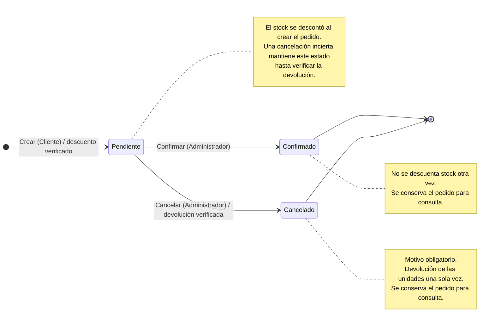

# Diagrama de estados del pedido — MasterMusic

## Propósito

Representa el ciclo de vida de la entidad `Pedido` de `MasterMusic.Ventas.Api` y sus efectos sobre el inventario administrado por `MasterMusic.Api`. Se contrastó con el código de la rama `feat/api-pedidos`, commit `3dcd4c3`, el 22 de noviembre de 2026.

La entidad define exactamente tres estados: `Pendiente`, `Confirmado` y `Cancelado`.

## Diagrama

Archivos del mismo diagrama:

- [Fuente Mermaid](Diagrama-estados-pedido-MasterMusic.mmd).
- [Versión SVG](Diagrama-estados-pedido-MasterMusic.svg).
- [Imagen PNG para el informe](Diagrama-estados-pedido-MasterMusic.png).

El círculo inicial representa la creación aceptada del pedido. Los círculos finales indican el cierre de su ciclo de cambios. Los pedidos confirmados y cancelados permanecen almacenados y pueden consultarse.

## Transiciones y efectos

| Origen | Acción y actor | Condición | Destino | Efecto en inventario |
|---|---|---|---|---|
| Inicio | El Cliente crea un pedido. | Datos válidos y movimiento de descuento comprobado en API 1. | Pendiente | Las cantidades solicitadas se descuentan al crear; API 2 guarda las líneas y precios confirmados. |
| Pendiente | El Administrador confirma el pedido. | Pedido existente, clave de operación válida y ausencia de otra transición en curso. | Confirmado | Se conserva el descuento inicial. Confirmar no genera un nuevo movimiento de stock. |
| Pendiente | El Administrador cancela e indica un motivo. | Motivo válido, descuento original vinculado y devolución de stock comprobada en API 1. | Cancelado | Se devuelven las cantidades del descuento original mediante un movimiento de devolución único. |

Las tres acciones requieren un JWT válido con el rol correspondiente y la cabecera `Idempotency-Key`. El identificador del Cliente se obtiene del JWT. La cancelación guarda el motivo; se admiten hasta 500 caracteres.

## Reglas de cambio

- `Confirmado` y `Cancelado` son estados finales para las operaciones de cambio implementadas.
- Una nueva operación de confirmación o cancelación sobre un pedido final devuelve HTTP 409 con `ESTADO_PEDIDO_INVALIDO`.
- Reintentar una operación con la misma cuenta, tipo, clave y datos recupera la operación existente y evita repetir sus efectos.
- Reutilizar una clave con datos diferentes devuelve HTTP 409 con `IDEMPOTENCIA_CONFLICTO`.
- Una intención de cambio en curso impide registrar otra transición sobre el mismo pedido; se responde HTTP 409 con `OPERACION_EN_CURSO`.
- El control de concurrencia y los bloqueos por pedido serializan los intentos simultáneos de confirmación y cancelación.

El registro público crea cuentas con rol Cliente. La gestión de confirmaciones y cancelaciones corresponde al rol Administrador.

## Respuestas inciertas y recuperación

La entidad `OperacionPedido` conserva la intención y los identificadores utilizados para coordinar las llamadas entre APIs.

**Durante la creación:** API 2 registra la operación antes de llamar a inventario. Si todavía no puede verificar el descuento, la operación queda recuperable y el pedido no se presenta como aceptado. Cuando se comprueba el movimiento, se guarda el pedido en estado Pendiente.

**Durante la cancelación:** API 1 puede haber devuelto el stock aunque la respuesta HTTP se pierda. En ese caso, API 2 mantiene el pedido Pendiente y la operación EnProceso hasta verificar el movimiento original. La recuperación consulta ese mismo movimiento; al comprobarlo, cambia el pedido a Cancelado sin repetir la devolución.

Las respuestas de creación, cambio o recuperación con una operación aún recuperable usan HTTP 202. El cliente conserva su clave y los datos de la solicitud para consultar o recuperar la operación. El estado técnico EnProceso pertenece a `OperacionPedido`; los estados de `Pedido` siguen siendo los tres que aparecen en el diagrama.

## Relación con las rutas de la API

| Acción | Ruta | Rol |
|---|---|---|
| Crear | `POST /api/v1.0/Pedidos` | Cliente |
| Consultar pedidos propios | `GET /api/v1.0/Pedidos` | Cliente |
| Consultar pedidos para su gestión | `GET /api/v1.0/admin/Pedidos` | Administrador |
| Confirmar | `POST /api/v1.0/admin/Pedidos/{idPedido}/confirmacion` | Administrador |
| Cancelar | `POST /api/v1.0/admin/Pedidos/{idPedido}/cancelacion` | Administrador |
| Consultar una operación | `GET /api/v1.0/Operaciones/{idOperacion}` | Propietario de la operación, con rol Cliente o Administrador |
| Recuperar una operación | `POST /api/v1.0/Operaciones/{idOperacion}/recuperacion` | Propietario de la operación y rol adecuado para su tipo |

## Evidencia y trazabilidad con el código

Implementación:

- `MasterMusic.Ventas.Api/Entities/EstadoPedido.cs`: valores de los estados.
- `MasterMusic.Ventas.Api/Entities/Pedido.cs`: métodos Confirmar, Cancelar y VerificarPendiente.
- `MasterMusic.Ventas.Api/Services/CreacionPedidosService.cs`: creación después de comprobar el descuento.
- `MasterMusic.Ventas.Api/Services/CambiosPedidosService.cs`: coordinación de cambios, devoluciones, reintentos y recuperación.
- `MasterMusic.Ventas.Api/Controllers/PedidosAdminController.cs`: autorización y respuestas de las transiciones.

Pruebas automatizadas implementadas para estas reglas:

- `Confirmar_NoDescuentaOtraVezNiDependeDeInventario`.
- `Cancelar_YReintentar_DevuelveUnaVezYGuardaMotivo`.
- `Finalizados_RechazanOtraTransicionConClaveNueva`.
- `RespuestaPerdida_DevolucionSeRecuperaSinRepetirStock`.
- `InventarioCaido_ConservaIntencionYExcluyeOtrosCambios`.
- `ConfirmacionYCancelacionConcurrentes_SoloUnaSeCompleta`.

Las capturas de `Documentacion/Evidencias/Semana-3` registran las pruebas manuales de cancelación con devolución de stock y confirmación conservando el descuento inicial. Los archivos `01-pedido-cancelado.png` y `02-stock-tras-cancelacion.png` corresponden a la cancelación; `03-pedido-confirmado.png` y `04-stock-tras-confirmacion.png` corresponden a la confirmación.
