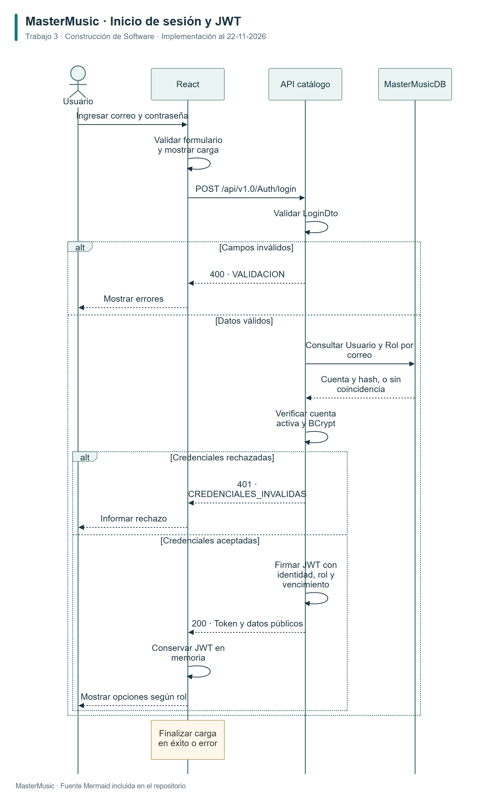
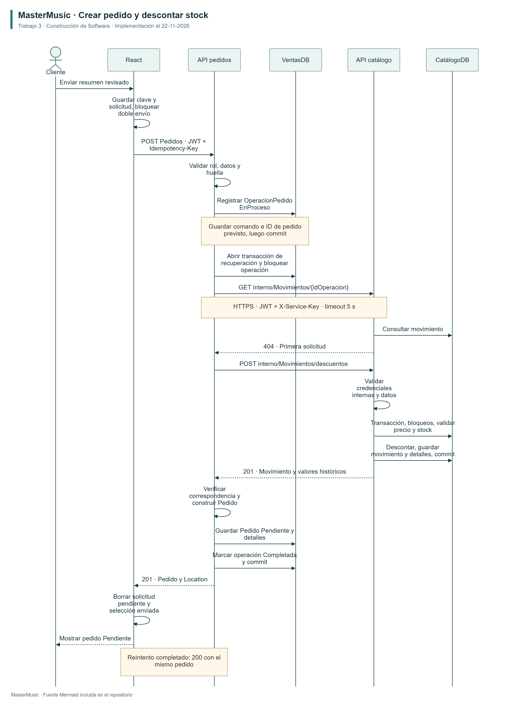
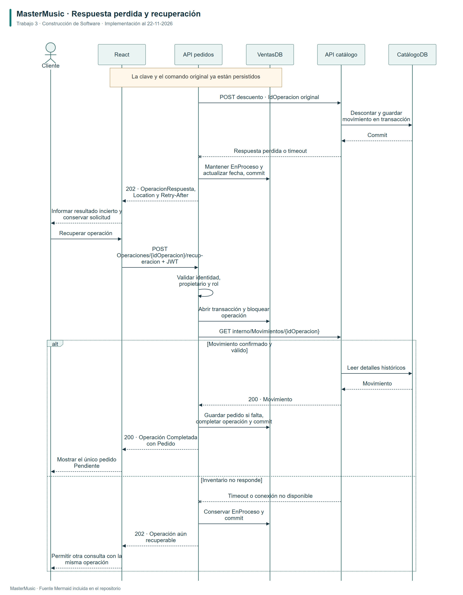

# Diagramas de secuencia de MasterMusic

Versión de implementación: 22 de noviembre de 2026. Las tres secuencias se contrastaron con AuthController, CreacionPedidosService, OperacionesController, InventarioClient, MovimientosController y la recuperación del cliente React.

API catálogo = MasterMusic.Api; API pedidos = MasterMusic.Ventas.Api. CatálogoDB = MasterMusicDB; VentasDB = MasterMusicVentasDB. Las rutas abreviadas parten de /api/v1.0 y las llamadas entre APIs utilizan HTTPS.

## 1. Inicio de sesión y obtención del JWT

[Fuente Mermaid](Diagramas/08-secuencia-login.mmd) · [SVG](Diagramas/08-secuencia-login.svg) · [PNG](Diagramas/08-secuencia-login.png)

RF-02, RNF-01/02/07/08. El hash BCrypt no sale de la API. React usa el token en memoria y muestra opciones por rol; los endpoints siguen siendo responsables de autorizar cada petición. Un 401 en una ruta protegida elimina la sesión del cliente; un 403 informa falta de permiso sin cerrarla.

## 2. Crear pedido con descuento de inventario

[Fuente Mermaid](Diagramas/09-secuencia-crear-pedido.mmd) · [SVG](Diagramas/09-secuencia-crear-pedido.svg) · [PNG](Diagramas/09-secuencia-crear-pedido.png)

RF-15 a RF-18, RF-21 y RNF-06. El camino mostrado corresponde a una clave nueva y un catálogo disponible. La primera llamada de recuperación consulta el movimiento antes de solicitar el descuento: esta consulta también ocurre en el alta normal.

La transacción que guarda la intención termina antes del HTTP. Después se abre otra transacción de Ventas, que serializa la recuperación y puede permanecer abierta durante las llamadas. Inventario usa su propia transacción. No existe un commit distribuido que abarque ambas bases.

Las cantidades y precios se verifican antes de descontar todas las líneas; un rechazo no acepta un pedido parcial. Los nombres y precios devueltos por inventario forman el detalle histórico. El constructor calcula el total con límite de entero seguro. El éxito inicial responde 201; un reintento ya completado, 200.

Pendiente significa pedido registrado, no operación técnica incierta. Confirmar después no descuenta otra vez. Los bloqueos e índices garantizan un único descuento por pedido.

## 3. Respuesta perdida y recuperación

[Fuente Mermaid](Diagramas/10-secuencia-recuperacion.mmd) · [SVG](Diagramas/10-secuencia-recuperacion.svg) · [PNG](Diagramas/10-secuencia-recuperacion.png)

RF-21/22 y RNF-06/07. En este caso inventario confirmó el descuento pero su respuesta se perdió. El 202 conserva una operación recuperable y no afirma que el pedido ya exista. Cada llamada HTTP tiene timeout de cinco segundos; no es un límite total del flujo.

La recuperación utiliza el ID de operación y una sesión vigente de su propietario. Si React desconoce el ID, consulta primero Operaciones por claveCliente y tipo. Si inventario responde 404, se reenvía el comando con los identificadores originales; nunca se cambia de clave a causa de un timeout.

El POST de recuperación devuelve OperacionRespuesta: al completarse contiene el pedido; mientras continúa, responde 202. Un GET de operación puede devolver 200 aunque su estado siga EnProceso, porque la consulta fue correcta.

Las pruebas simulan pérdida de respuesta, caída de inventario y reintentos. La recuperación explícita está implementada; la compensación automática de altas que aparecía en la propuesta inicial no lo está. Cancelar un pedido sí implementa una devolución idempotente antes de cambiarlo a Cancelado.

## Relación con los demás modelos

Cada API accede a su base. La [arquitectura](Arquitectura-MasterMusic.md), el [modelo ER](Modelo-entidad-relacion-MasterMusic.md), el [estado del pedido](Diagrama-estados-pedido-MasterMusic.md) y la [comparación de contratos](Contratos/Comparacion-diseno-implementacion.md) explican las mismas responsabilidades y límites.

Los tres archivos Mermaid y sus exportaciones SVG/PNG acompañan este documento. Esta revisión documental no cambia las APIs ni exige repetir la suite de código por sí sola.
