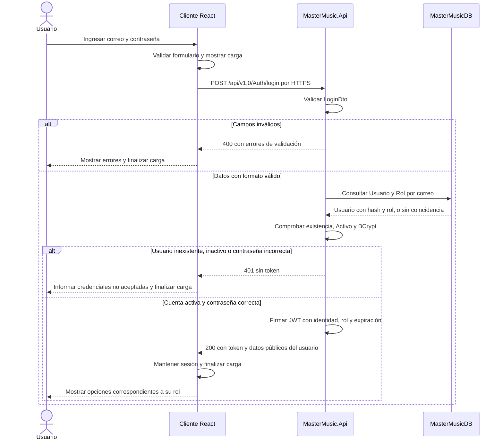
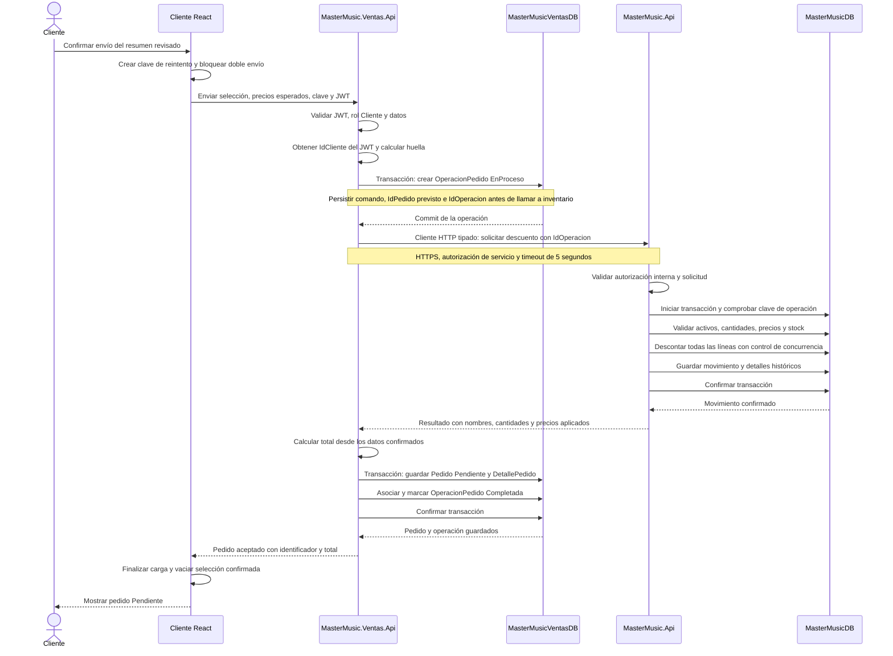
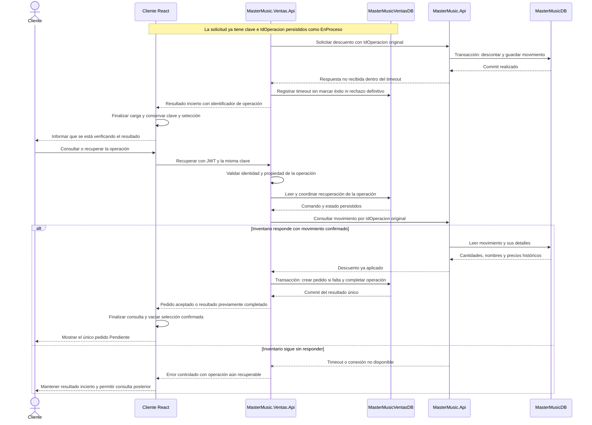

# Diagramas de secuencia de MasterMusic

Este documento describe tres flujos del diseño del Trabajo 3: autenticación, registro de un pedido y recuperación ante un fallo de comunicación. Cubre el mínimo de secuencias del Hito 2 y relaciona el cliente React, las dos APIs y sus bases de datos.

La autenticación parte del comportamiento existente. React, la segunda API y los mecanismos de pedidos y recuperación representan el comportamiento que se implementará. Los nombres de las operaciones son descriptivos; sus rutas, esquemas y códigos HTTP se concretarán en los contratos OpenAPI.

## 1. Inicio de sesión y obtención del JWT

Requisitos: RF-02, RNF-01, RNF-02 y RNF-07. El usuario inicia sesión con su correo y contraseña. La primera API comprueba los datos, el estado de la cuenta y el hash de la contraseña antes de emitir el token.

El hash no sale de la API. Las contraseñas y el JWT no se escriben en logs. Mostrar u ocultar opciones en React no sustituye la autorización de los endpoints. Las APIs validan el JWT en cada operación protegida.

El 401 del login representa credenciales no aceptadas. Un 401 en una operación protegida provoca que React deje de usar la sesión inválida y solicite iniciar sesión nuevamente; un 403 informa falta de permisos sin cerrar una sesión válida, como indica RNF-08.

## 2. Registro de un pedido con descuento de existencias

Requisitos: RF-15 a RF-18, RF-21 y RNF-06. Este flujo muestra el camino exitoso después de revisar el resumen. Recorre React, la API de pedidos, la API de catálogo y las dos bases de datos.

### Condiciones del flujo

- El cliente solo envía precios esperados para detectar cambios; el servidor determina los precios aceptados y el total. Si cambia un precio, no se aplica el descuento y se solicita revisar el resumen.
- Si un instrumento está inactivo o falta stock en cualquier línea, se revierte la transacción completa de inventario. No se acepta un pedido parcial.
- Se prohíbe stock negativo mediante actualizaciones condicionales, restricciones y control de concurrencia; leer y después sobrescribir el stock no basta.
- La misma clave de cliente, tipo de operación y usuario identifica la misma solicitud. Si su contenido cambia, se devuelve conflicto. Si ya terminó, se devuelve el resultado existente; si sigue en proceso, se informa ese estado sin iniciar otra operación independiente.
- Los índices únicos de movimiento evitan repetir un descuento aunque dos solicitudes se ejecuten simultáneamente. La respuesta a un reintento debe corresponder al movimiento persistido.
- Una operación que está en proceso no se presenta como pedido aceptado. Pendiente es el estado comercial después de completar el registro, no un sinónimo de fallo o procesamiento técnico.
- El registro del pedido no acredita un pago. La confirmación administrativa posterior no descuenta stock otra vez.

## 3. Timeout al descontar stock y recuperación del resultado

Requisitos: RF-21, RF-22, RNF-06 y RNF-07. El caso representado es una respuesta perdida: inventario alcanzó a confirmar el descuento, pero la API de pedidos no recibió su respuesta dentro del plazo. Un timeout no demuestra que la otra API no haya realizado la operación.

### Reglas de recuperación

- La recuperación consulta y reutiliza el identificador original: no crea una nueva compra ni un nuevo descuento. La consulta y recuperación están protegidas; un cliente no puede recuperar operaciones de otro.
- El timeout es de cinco segundos por llamada HTTP, no una promesa de duración máxima de todo el proceso. Las respuestas de error no exponen excepciones internas ni secretos.
- Si la consulta no encuentra un movimiento, puede existir una solicitud concurrente todavía ejecutándose. Se reenvía el mismo comando con la misma clave; la transacción y los índices únicos determinan un solo resultado. No se cambia la clave por haber recibido un timeout.
- La recuperación debe coordinarse en la base de pedidos para evitar que dos ejecutores finalicen o compensen a la vez. Las escrituras de Pedido, sus detalles y la finalización de OperacionPedido ocurren en una transacción local.
- Si falla el guardado del pedido después del descuento, se mantiene el comando para reanudarlo. Si se determina que el pedido no puede completarse, se persiste EnCompensacion y una clave única de devolución antes de llamar a inventario. Solo se marca Compensada después de confirmar la devolución. Un fallo al devolver también exige consulta y recuperación con la misma clave.
- Una cancelación administrativa usa el mismo principio de persistir, ejecutar y comprobar: bloquea una confirmación concurrente, devuelve stock una sola vez y después marca Cancelado. El motivo se conserva desde el inicio de esa operación.

## Consistencia del diseño

Las secuencias usan las responsabilidades definidas en Arquitectura-MasterMusic.md y las tablas de Modelo-entidad-relacion-MasterMusic.md. Ninguna API accede directamente a la base de la otra. Cada base ofrece transacciones locales; el sistema completo se recupera mediante operaciones persistentes e idempotencia, no mediante una transacción SQL compartida.

Los contratos OpenAPI especificarán rutas y respuestas concretas para aceptación, conflicto, operación en proceso, consulta, recuperación y dependencia no disponible. Esas distinciones deben reflejarse en React y en las pruebas, especialmente cuando un pedido aún no puede mostrarse como aceptado.

El archivo conserva la fuente Mermaid y la explicación de cada secuencia. Sus exportaciones visuales acompañarán a las fuentes en la entrega del Trabajo 3.
