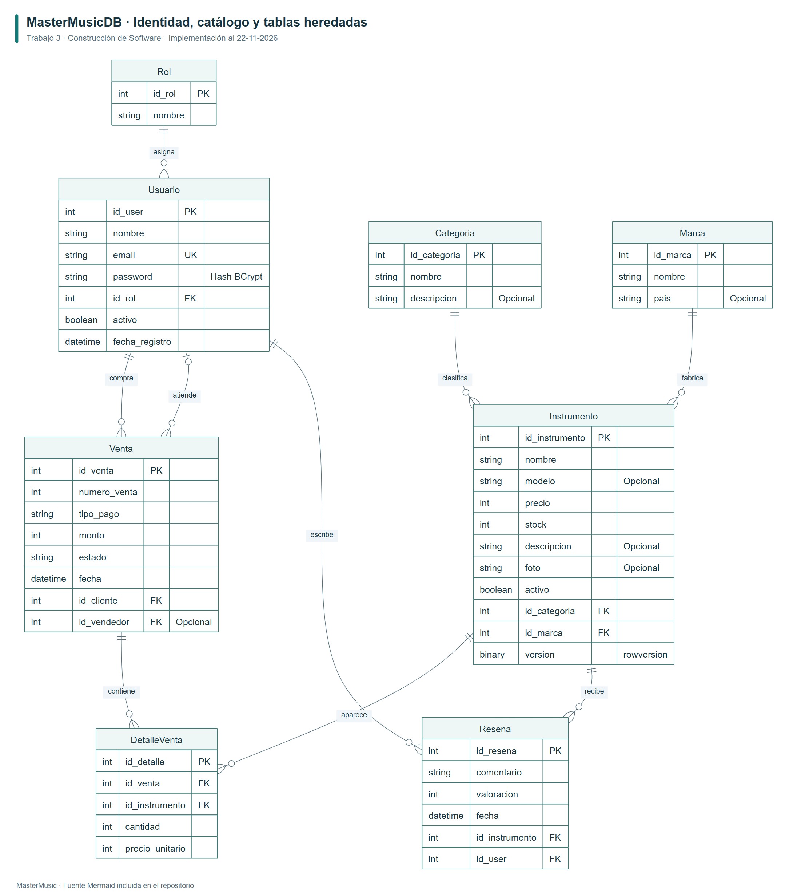
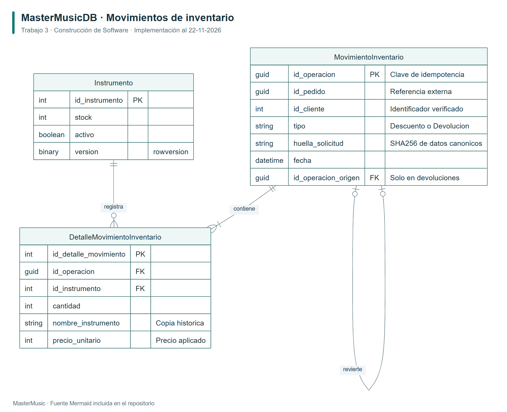
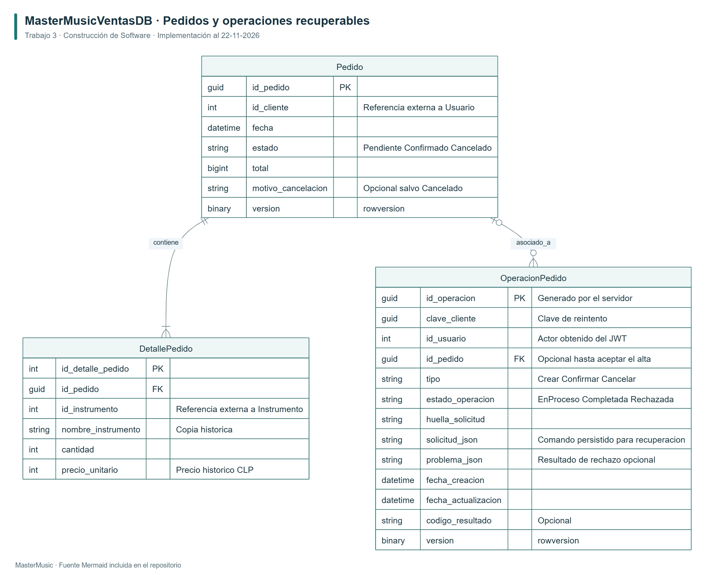

# Modelo entidad–relación de MasterMusic

Versión de implementación: 22 de noviembre de 2026. El modelo se contrastó con entidades, configuraciones EF Core, snapshots y migraciones del código final. Los diagramas muestran tablas de negocio; cada base incluye además la tabla técnica __EFMigrationsHistory.

PK = clave primaria; FK = clave foránea de la misma base; UK = clave única. Los Guid se almacenan como uniqueidentifier, long como bigint y Version como rowversion. Las referencias entre APIs no son FK.

## MasterMusicDB: identidad, catálogo y legado

[Fuente Mermaid](Diagramas/05-er-catalogo-y-legado.mmd) · [SVG](Diagramas/05-er-catalogo-y-legado.svg) · [PNG](Diagramas/05-er-catalogo-y-legado.png)

Rol, Usuario, Categoria, Marca e Instrumento forman el catálogo activo. Venta, DetalleVenta y Resena se conservan del Trabajo 2; no representan los pedidos nuevos ni habilitan pagos o reseñas en el cliente.

Un usuario tiene un rol. Un instrumento tiene una categoría y una marca. Venta tiene un cliente obligatorio y un vendedor opcional, ambos de Usuario. El modelo heredado permite cero o más detalles por Venta. Usuario.email tiene índice único, incorporado por CorreoUsuarioUnico.

## MasterMusicDB: inventario de pedidos

[Fuente Mermaid](Diagramas/06-er-inventario.mmd) · [SVG](Diagramas/06-er-inventario.svg) · [PNG](Diagramas/06-er-inventario.png)

Instrumento se repite como referencia parcial; conserva los atributos de la primera vista. Un movimiento aceptado contiene al menos un detalle por validación de la aplicación; la FK por sí sola no garantiza ese mínimo. Una devolución referencia un descuento del mismo pedido y cliente, y toma sus cantidades y precios históricos.

| Restricción implementada | Efecto |
| --- | --- |
| PK MovimientoInventario.id_operacion | Identifica el movimiento de forma única. |
| Índice único filtrado en id_pedido donde tipo = Descuento | Un descuento por pedido. No es un índice compuesto id_pedido + tipo. |
| Índice único filtrado en id_operacion_origen no nulo | Una devolución por descuento. |
| Índice único en DetalleMovimientoInventario(id_operacion, id_instrumento) | Un instrumento por movimiento. |
| CHECK Instrumento.stock >= 0 | Impide existencias negativas en SQL. |
| CHECK cantidad > 0 y precio_unitario > 0 en detalles de movimiento | Conserva cantidades y precios positivos. |
| FK con borrado restringido hacia instrumento, movimiento y origen | Conserva el historial de movimientos. |

El tipo y la correspondencia del origen se comprueban en los controladores; no se atribuye al esquema SQL una restricción CHECK inexistente. La huella es SHA256 almacenada en nvarchar(64), no char(64).

El descuento usa bloqueos de aplicación y bloqueos de actualización de instrumentos en orden estable, dentro de una transacción. Version aporta control de concurrencia EF Core. La creación del movimiento y el cambio de stock confirman juntos.

Las FK heredadas mantienen las acciones definidas en la migración inicial, incluidas cascadas. Los endpoints administrativos comprueban referencias antes de eliminar categorías o marcas. InstrumentoRepository exige stock cero y ausencia de detalles de venta, reseñas y movimientos. No se afirma que todas las FK heredadas hayan sido cambiadas a Restrict.

## MasterMusicVentasDB: pedidos y operaciones

[Fuente Mermaid](Diagramas/07-er-pedidos.mmd) · [SVG](Diagramas/07-er-pedidos.svg) · [PNG](Diagramas/07-er-pedidos.png)

Pedido contiene una o más líneas por validación de su constructor y servicio. OperacionPedido puede asociarse a cero o un pedido; un pedido puede tener varias operaciones. Antes de completar el alta, el ID previsto queda en solicitud_json y la FK id_pedido puede ser nula.

| Restricción implementada | Efecto |
| --- | --- |
| Índice único en OperacionPedido(id_usuario, tipo, clave_cliente) | Reintento identificable por actor, tipo y clave. La huella detecta datos distintos. |
| Índice único en DetallePedido(id_pedido, id_instrumento) | No repite un instrumento dentro del pedido. |
| Índice en Pedido(id_cliente, fecha) | Apoya la consulta propia. |
| CHECK total entre 1 y 9007199254740991 | Total compatible con enteros exactos de JavaScript. |
| CHECK estado Pendiente / Confirmado / Cancelado | Estados comerciales permitidos. |
| CHECK motivo obligatorio en Cancelado y nulo en los demás | Conserva la razón de cancelación. |
| CHECK cantidad y precio_unitario positivos | Validez de las líneas. |
| FK de detalles y operaciones hacia Pedido con Restrict | Conserva referencias; no hay endpoint de borrado de pedidos. |

estado tiene longitud máxima 20; tipo y estado_operacion, 20; huella_solicitud, 64; codigo_resultado, 80; motivo_cancelacion, 500; nombre_instrumento, 150. solicitud_json y problema_json son nvarchar(max), sin CHECK ISJSON en las migraciones actuales.

Los servicios producen EnProceso, Completada y Rechazada. No existe la columna id_operacion_compensacion del diseño inicial. ProblemaJson conserva rechazos y SolicitudJson el comando para recuperación; no guardan JWT ni contraseñas. Las fechas de pedidos, movimientos y operaciones nuevas se crean en UTC.

## Referencias entre bases y normalización

Pedido.id_cliente y OperacionPedido.id_usuario remiten a cuentas verificadas por JWT; DetallePedido.id_instrumento remite al catálogo; MovimientoInventario.id_pedido remite al ID previsto o existente. No se crean FK entre bases ni se comparte DbContext.

**Primera forma normal:** cada tabla relacional contiene valores por atributo y una fila por detalle. Los documentos JSON de operación son una excepción técnica deliberada para conservar comandos y resultados; no sustituyen las líneas relacionales del pedido.

**Segunda forma normal:** cada fila depende de su clave completa. Los índices compuestos de detalle evitan duplicados del mismo recurso dentro de una cabecera.

**Tercera forma normal:** roles, categorías y marcas se separan del catálogo; Pedido no duplica correo ni datos personales del cliente. Nombre y precio históricos dependen de la línea aceptada y se mantienen aunque cambie el catálogo.

Total es un valor derivado almacenado de forma controlada; el constructor lo calcula desde los detalles. El historial copiado en movimiento y pedido permite recuperar una respuesta perdida, sin sincronizarlo con precios futuros.

## Migraciones y verificación

| API | Migraciones del repositorio |
| --- | --- |
| Catálogo | InitialCreate; InventarioPedidos; CorreoUsuarioUnico. |
| Pedidos | InicialPedidos; OperacionesPedidos. |

La actualización documental no crea ni ejecuta migraciones. El esquema efectivo de una instalación requiere aplicar las migraciones con los comandos del README. La suite incluye pruebas SQL de integridad y concurrencia y una comprobación del modelo respecto al snapshot.

Requisitos: RF-01/02, RF-04 a RF-13 y RF-16 a RF-22. RF-14/15 pertenecen a la selección React, sin tabla Carrito. Véanse la [matriz](Matriz-trazabilidad-MasterMusic.md) y los [contratos implementados](Contratos/Comparacion-diseno-implementacion.md).
