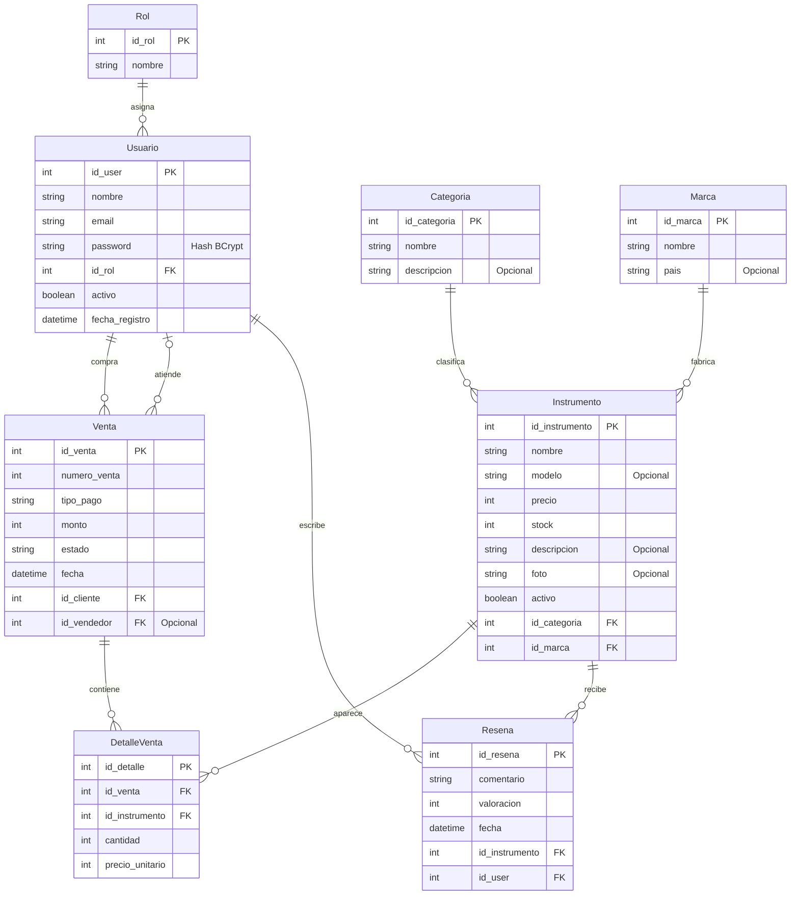
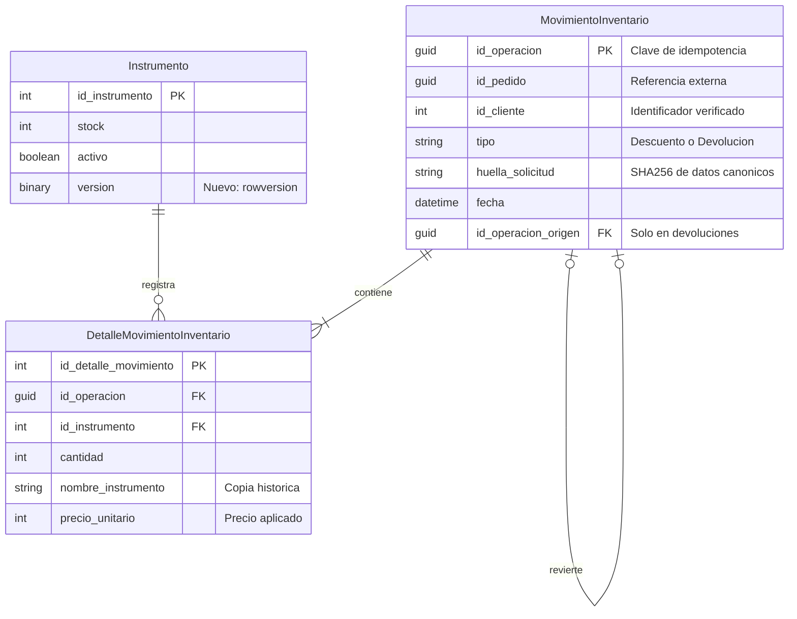
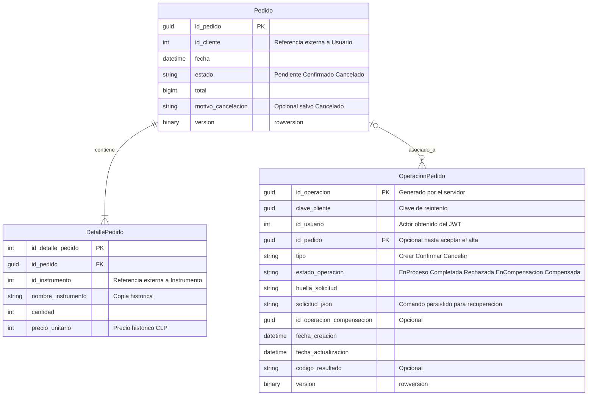

# Modelo entidad–relación de MasterMusic

Este documento presenta el modelo existente de MasterMusicDB y el diseño de datos para incorporar pedidos mediante MasterMusicVentasDB. Cubre el Hito 2 del Trabajo 3: tablas, claves, cardinalidades y justificación de normalización. Las ampliaciones descritas se implementarán mediante nuevas migraciones; este archivo no modifica las bases de datos.

PK identifica una clave primaria, FK una clave foránea dentro de la misma base y UK una clave única. Las referencias entre APIs se conservan como identificadores externos, sin claves foráneas entre bases. Los nombres de las tablas nuevas siguen la convención de nombres del proyecto.

## 1. MasterMusicDB: tablas existentes

Esta base pertenece a MasterMusic.Api. El siguiente diagrama refleja las ocho entidades del código actual. Se conserva el modelo del Trabajo 2, incluidas sus tablas de ventas y reseñas.

Un usuario tiene exactamente un rol. Un instrumento pertenece a una categoría y una marca. Una venta tiene un cliente y puede tener un vendedor; ambos identificadores apuntan a Usuario. La relación Venta–DetalleVenta se muestra con cero o más detalles porque la base existente no obliga a que una venta tenga al menos uno.

Venta, DetalleVenta y Resena son tablas heredadas. No representan el flujo nuevo de pedidos y no se eliminan ni migran automáticamente a la segunda base. Los pedidos del Trabajo 3 no incluyen pagos online ni reseñas.

## 2. MasterMusicDB: ampliación para movimientos de pedidos

La primera API será la única que modifique el stock. Se incorporan dos tablas para registrar descuentos y devoluciones de pedidos de manera recuperable. Una entrada administrativa de existencias seguirá siendo una actualización atómica del stock; no requiere un pedido asociado.

Instrumento aparece aquí únicamente con los campos relevantes para la ampliación; conserva todos los atributos del primer diagrama. version es una columna rowversion de SQL Server, no una fecha.

Cada movimiento confirmado contiene uno o más detalles. Una devolución referencia un descuento previo y copia sus cantidades; no acepta cantidades arbitrarias del cliente. Un descuento tiene como máximo una devolución. El descuento es único para cada pedido, aunque alguien envíe una clave de operación distinta.

### Restricciones y transacciones de inventario

- Índice único compuesto en MovimientoInventario (id_pedido, tipo).
- Índice único filtrado en id_operacion_origen cuando no sea nulo; una restricción adicional comprueba que Descuento no tenga origen y Devolucion sí lo tenga. El servicio verifica que el origen sea un descuento del mismo pedido y cliente.
- Índice único compuesto en DetalleMovimientoInventario (id_operacion, id_instrumento). La solicitud debe agrupar o rechazar instrumentos repetidos antes de descontar.
- cantidad y precio_unitario deben ser positivos. Instrumento.stock debe ser no negativo y precio positivo, con validaciones de API y restricciones CHECK nuevas en SQL Server.
- Validación de disponibilidad, precios, descuento de todas las líneas y registro del movimiento se ejecutan en una misma transacción de MasterMusicDB. Una operación parcialmente aplicada se revierte.
- La concurrencia se controla con actualizaciones condicionales y version. Ante conflicto se revierte toda la transacción y se vuelve a comprobar la solicitud; no se sobrescribe stock leído anteriormente.
- La misma clave con la misma solicitud devuelve el movimiento ya registrado. Con contenido diferente devuelve conflicto. La huella incluye tipo, pedido, cliente, instrumentos, cantidades y precios esperados, ordenados de forma determinista.
- Las devoluciones recuperan el movimiento original y comprueban límites al sumar stock, evitando desbordamientos de int.
- DetalleMovimientoInventario conserva su FK hacia Instrumento con borrado restringido. Esto permite impedir localmente la eliminación de un instrumento usado por pedidos, incluso si la segunda API no está disponible. También se comprobarán los detalles de venta heredados y stock cero. No se borran movimientos para eludir esta regla.
- Los movimientos solo se crean mediante operaciones internas autorizadas entre APIs; exponer estas tablas no concede al cliente permiso para modificar existencias.

El registro contiene movimientos completados, no una fila que afirme éxito antes de aplicar el stock. Si se pierde una respuesta HTTP después del commit, la segunda API podrá consultar el movimiento por id_operacion. La ausencia momentánea de una fila no prueba que una solicitud concurrente haya terminado: cualquier reintento utiliza la misma clave y las restricciones de unicidad.

## 3. MasterMusicVentasDB: pedidos y recuperación

Esta base pertenece a MasterMusic.Ventas.Api. Pedido representa una solicitud aceptada y no acredita un pago. OperacionPedido conserva las solicitudes en proceso y permite recuperar resultados inciertos sin confundirlos con estados comerciales del pedido.

Un pedido tiene uno o más detalles y puede estar asociado a varias operaciones. Una operación pertenece como máximo a un pedido existente. Al comenzar el alta aún no existe Pedido, por lo que OperacionPedido.id_pedido es nulo. El identificador previsto del nuevo pedido queda guardado en solicitud_json y se mantiene durante todos los reintentos; al completar el alta se establece la FK.

### Campos, índices y reglas de pedidos

- Los identificadores Guid se almacenan como uniqueidentifier; las fechas nuevas se guardan en UTC con datetime2; version usa rowversion. Los enteros long de C# se almacenan como bigint.
- Se propone nvarchar(20) para estado, nvarchar(20) para tipo, nvarchar(30) para estado_operacion, nvarchar(500) para motivo_cancelacion y nvarchar(150) para nombre_instrumento. Las huellas SHA256 se almacenan como char(64). solicitud_json usa nvarchar(max), con comprobación ISJSON.
- Índice único en OperacionPedido (id_usuario, tipo, clave_cliente). La misma clave y actor no crean otra operación del mismo tipo. Se compara también la huella para rechazar solicitudes distintas.
- La API de pedidos genera id_operacion y lo utiliza como clave de las llamadas a inventario. El cliente no elige las claves internas de otros usuarios.
- Índice único compuesto en DetallePedido (id_pedido, id_instrumento); índice de consulta en Pedido (id_cliente, fecha).
- CHECK para cantidad positiva, precio_unitario positivo, total positivo y estados permitidos. Cancelado exige motivo no vacío; los demás estados no tienen motivo de cancelación.
- La cabecera y todos sus detalles se guardan en una transacción. La aplicación garantiza al menos un detalle; una FK por sí sola no garantiza ese mínimo.
- total es la suma de cantidades por precios históricos, calculada en el servidor usando bigint y comprobando desbordamiento. No se guarda un subtotal adicional por línea.
- Confirmado y Cancelado son estados finales. Los pedidos y sus detalles no se eliminan mediante la API. La FK DetallePedido–Pedido usará borrado restringido.
- Confirmar o cancelar exige una operación persistida. Una transacción y el control de concurrencia de Pedido serializan el inicio de esas acciones: si ya hay una en proceso para el pedido, se rechaza otra distinta. Ambas rutas deben aplicar ese control; un rowversion aislado no garantiza todo el flujo.
- El servicio guarda el motivo de cancelación en el comando antes de devolver stock. Solo después de confirmar la devolución cambia el estado comercial a Cancelado.

### Recuperación ante fallos

El comando persistido contiene identificadores, cantidades, precios esperados y motivo cuando corresponda; no almacena JWT, contraseñas ni credenciales de servicio. Se usa un formato versionado para que el servidor pueda interpretarlo al recuperar la operación.

Si el stock ya se descontó y falla la creación del pedido, el servidor puede recuperar nombres, cantidades y precios desde el movimiento y completar el guardado. Si se determina que no puede completarse, primero registra EnCompensacion y una clave persistente de devolución; después solicita y verifica esa devolución. Solo entonces registra Compensada. El proceso de recuperación debe excluir que dos ejecutores intenten finalizar y compensar simultáneamente.

Una cancelación interrumpida se reanuda con la misma operación. Mientras el resultado sea incierto, la consulta distingue el estado comercial del progreso técnico y no muestra una cancelación terminada. Los contratos definirán los endpoints de consulta y recuperación y las respuestas HTTP; no se promete atomicidad entre las dos bases.

## 4. Referencias entre bases

| Referencia lógica | Validación |
|---|---|
| Pedido.id_cliente → Usuario.id_user | Identidad obtenida del JWT validado; acceso a pedidos propios o autorización de Administrador. |
| DetallePedido.id_instrumento → Instrumento.id_instrumento | Validación por la primera API al aceptar el pedido; se conservan los datos históricos. |
| MovimientoInventario.id_pedido → identificador previsto o existente de Pedido | Solicitud autenticada de la API de pedidos y clave de operación persistida. Puede existir antes de que termine el alta del pedido. |

No se crean FK entre MasterMusicDB y MasterMusicVentasDB. Las dos APIs no comparten un DbContext ni realizan consultas directas a la base de la otra. Las lecturas del historial de pedidos utilizan sus detalles históricos y no dependen del precio o nombre actual del catálogo.

## 5. Normalización

**Primera forma normal:** las tablas del dominio tienen atributos individuales y una fila por detalle; no se guardan listas de instrumentos en Pedido. solicitud_json es una excepción técnica deliberada: guarda el mensaje de una operación para reanudarla, no sustituye las tablas normalizadas del negocio ni se presenta como estructura relacional en tercera forma normal.

**Segunda forma normal:** cada fila tiene una PK y los atributos describen esa fila completa. Las restricciones únicas de detalle evitan duplicar un instrumento dentro de un mismo pedido o movimiento.

**Tercera forma normal:** roles, categorías y marcas se almacenan en tablas propias; sus nombres no se repiten como datos actuales en Usuario o Instrumento. Pedido no copia el correo o los datos completos del cliente. Los detalles describen la línea histórica de la operación, no el catálogo actual.

Nombre y precio históricos se conservan intencionalmente para RF-17: no se actualizan cuando cambia Instrumento. La copia en el movimiento permite reconstruir el pedido si falla la comunicación. total es un dato derivado almacenado de forma controlada: se calcula al aceptar el pedido y no se edita independientemente de sus detalles. Estas duplicaciones tienen una finalidad de historial y recuperación, no deben confundirse con datos actuales que deban sincronizarse.

## 6. Cambios mediante migraciones

La migración original se conserva. Las tablas nuevas de inventario, rowversion, restricciones CHECK e índices se añadirán mediante migraciones posteriores. También se incorporará un índice único de correo para RF-01, después de revisar posibles duplicados y definir la normalización del correo. No se marca como ya existente en el primer diagrama.

Se revisarán las FK heredadas que actualmente permiten eliminar detalles históricos en cascada. El cambio a borrado restringido se realizará con una migración y comprobación de los datos existentes. No se eliminarán tablas ni datos automáticamente.

MasterMusicVentasDB tendrá su propio contexto y migración inicial. La estructura propuesta amplía el diagrama de clases con registros técnicos de recuperación; no agrega nuevos estados comerciales a EstadoPedido.

## 7. Relación con requisitos

| Diseño | Requisitos |
|---|---|
| Usuario, Rol e índice único de correo | RF-01 y RF-02. |
| Instrumento, Categoria, Marca y concurrencia de stock | RF-04 a RF-13. |
| Pedido y DetallePedido con datos históricos | RF-16 a RF-20. |
| OperacionPedido, movimientos y devoluciones únicas | RF-21 y RF-22. |
| Selección y resumen en React, sin tabla Carrito | RF-14 y RF-15. |

Este archivo contiene la fuente Mermaid de los tres diagramas y su explicación. Las exportaciones visuales acompañarán al archivo fuente en la entrega.
