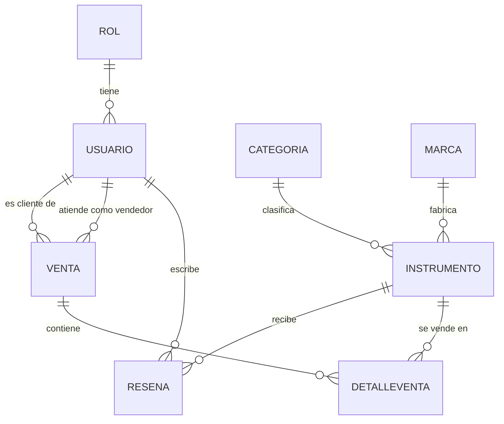

# MasterMusic API

API RESTful para la gestión de una tienda de instrumentos musicales, desarrollada con **ASP.NET Core Web API** (controladores), **Entity Framework Core** sobre **SQL Server**, autenticación **JWT** y autorización por roles.

* **Asignatura:** Construcción de Software, Trabajo 2
* **Alumno:** Roberto Acuña Campos


## Índice

1. [Caso de negocio](#caso-de-negocio)
2. [Modelo de datos](#modelo-de-datos)
3. [Tecnologías](#tecnologías)
4. [Arquitectura](#arquitectura)
5. [Configuración y ejecución](#requisitos-previos)
6. [Endpoints](#endpoints)
7. [Pruebas de integración](#pruebas-de-integración)
8. [Evidencias](#evidencias)

\---

## Caso de negocio

**Contexto.** MasterMusic es una tienda de instrumentos musicales. Sin un sistema central, el catálogo, el stock y las ventas suelen llevarse en planillas o registros separados, lo que dificulta saber qué instrumentos hay disponibles, cuánto se ha vendido y quién atendió cada venta.

**Solución.** Una API RESTful que centraliza el catálogo de instrumentos (clasificados por categoría y marca), el registro de ventas con su detalle y las reseñas de los clientes, con acceso controlado por usuarios y roles.

**Validación del caso.** El caso fue presentado al docente con el nombre del proyecto y el diagrama de la base de datos (`Evidencias/diagrama-bd.png`). 

### Usuarios y roles

|Rol|Cómo se obtiene|Qué puede hacer|
|-|-|-|
|Público (sin sesión)|No requiere cuenta|Consultar el catálogo de instrumentos|
|**Cliente**|Se asigna automáticamente al registrarse|Lo anterior, y además registrarse e iniciar sesión|
|**Administrador**|Se crea al iniciar la aplicación con credenciales de variables de entorno|Todo lo anterior, más crear, modificar y eliminar instrumentos|

### Reglas de negocio implementadas

* Cada instrumento pertenece a una categoría y a una marca, que deben existir.
* El precio debe ser mayor a 0 y el stock no puede ser negativo.
* Solo el administrador gestiona el catálogo (crear, modificar y eliminar).
* Quien se registra queda con el rol Cliente. Las contraseñas se guardan cifradas con BCrypt.
* Los endpoints protegidos exigen un token JWT válido.

### Alcance actual

El recurso principal es **`Instrumento`**, con CRUD completo. Las demás entidades (`Venta`, `DetalleVenta`, `Resena`, `Categoria`, `Marca`) están modeladas y mapeadas en la base de datos, pero todavía no tienen endpoints propios. El modelo también contempla un vendedor en cada venta (`id\_vendedor`), pensado como una extensión futura.

\---

## Modelo de datos

Base de datos: `MasterMusicDB` (SQL Server). El diagrama completo está en [`Evidencias/diagrama-bd.png`](Evidencias/diagrama-bd.png).



|Tabla|Campos principales|Descripción|
|-|-|-|
|`Rol`|id\_rol, nombre|Roles del sistema (Cliente, Administrador)|
|`Usuario`|id\_user, nombre, email, password, id\_rol, activo, fecha\_registro|Personas que usan el sistema|
|`Categoria`|id\_categoria, nombre, descripcion|Clasificación de instrumentos (por ejemplo, Guitarras)|
|`Marca`|id\_marca, nombre, pais|Fabricante del instrumento|
|`Instrumento`|id\_instrumento, nombre, modelo, precio, stock, descripcion, foto, activo, id\_categoria, id\_marca|**Recurso principal del CRUD**|
|`Venta`|id\_venta, numero\_venta, tipo\_pago, monto, estado, fecha, id\_cliente, id\_vendedor|Cabecera de cada venta|
|`DetalleVenta`|id\_detalle, id\_venta, id\_instrumento, cantidad, precio\_unitario|Instrumentos incluidos en cada venta|
|`Resena`|id\_resena, comentario, valoracion, fecha, id\_instrumento, id\_user|Opinión de un usuario sobre un instrumento|

\---

## Tecnologías

|Componente|Detalle|
|-|-|
|Plataforma|.NET 10, ASP.NET Core Web API con controladores|
|ORM|Entity Framework Core 10 (SQL Server), enfoque *code first* con migraciones|
|Seguridad|JWT Bearer, contraseñas con BCrypt|
|Versionamiento|`Asp.Versioning.Mvc`, versión en la URL|
|Documentación|Swagger (Swashbuckle)|
|Pruebas|xUnit, `WebApplicationFactory`, EF Core InMemory|

## Arquitectura

```
Petición HTTP
   │
   ▼
RequestLoggingMiddleware   (middleware propio: registra entrada, salida y tiempo)
   │
   ▼
Autenticación JWT / Autorización por rol
   │
   ▼
Controllers                (AuthController, InstrumentosController)
   │
   ▼
Repository                 (IInstrumentoRepository → InstrumentoRepository)
   │
   ▼
MasterMusicContext (EF Core) ──► SQL Server
```

|Carpeta|Contenido|
|-|-|
|`Controllers/`|Endpoints de autenticación e instrumentos|
|`Middleware/`|`RequestLoggingMiddleware`|
|`Interfaces/` y `Repositories/`|Patrón Repository para `Instrumento`|
|`Data/`|`MasterMusicContext` y `SeedData` (roles y administrador inicial)|
|`Entities/`|Entidades mapeadas a las tablas|
|`Dtos/`|Objetos de registro y login|
|`Migrations/`|Migraciones de EF Core|

**Inyección de dependencias:** `MasterMusicContext` y `IInstrumentoRepository` se registran con ciclo de vida *scoped* (una instancia por petición HTTP).

\---

## Requisitos previos

* .NET 10 SDK
* SQL Server o SQL Server Express (en esta guía, la instancia `.\\SQLEXPRESS`)
* Visual Studio 2026 (o la CLI de .NET)

## Configuración

Las credenciales **no están en el repositorio**: se leen desde variables de entorno. En PowerShell, ejecuta lo siguiente con tus propios valores:

```powershell
setx ConnectionStrings\_\_MasterMusic "Server=.\\SQLEXPRESS;Database=MasterMusicDB;Trusted\_Connection=True;TrustServerCertificate=True;"
setx Jwt\_\_Key "una-llave-larga-y-aleatoria-de-al-menos-32-caracteres"
setx Admin\_\_Email "correo-del-administrador@ejemplo.cl"
setx Admin\_\_Password "clave-del-administrador"
```

|Variable|Para qué sirve|
|-|-|
|`ConnectionStrings\_\_MasterMusic`|Conexión a SQL Server|
|`Jwt\_\_Key`|Llave con la que se firman los tokens JWT|
|`Admin\_\_Email` y `Admin\_\_Password`|Crean el usuario administrador inicial (opcionales)|

Después de crear las variables, **cierra y vuelve a abrir** Visual Studio o la terminal, porque solo las leen los programas que se inician después.

El emisor y la audiencia del token (`Jwt:Issuer` y `Jwt:Audience`) están en `appsettings.json` porque no son secretos.

## Base de datos

Con la cadena de conexión configurada, aplica las migraciones. Esto crea la base `MasterMusicDB` y sus tablas.

En la **Consola del Administrador de paquetes** de Visual Studio (proyecto predeterminado `MasterMusic.Api`):

```powershell
Update-Database
```

O con la CLI, si tienes instalada la herramienta `dotnet-ef`:

```powershell
dotnet ef database update --project MasterMusic.Api
```

**Ejecuta las migraciones antes de iniciar la API por primera vez**, porque al arrancar la aplicación consulta las tablas de roles y usuarios.

## Ejecución

Desde Visual Studio, presiona `Ctrl+F5` (sin depurador) o `F5`. Con la CLI:

```powershell
dotnet run --project MasterMusic.Api
```

* Swagger: `https://localhost:7052/swagger`
* Swagger solo se habilita en el entorno `Development` (el perfil de `launchSettings.json` ya lo define).
* Al iniciar, la aplicación crea los roles **Cliente** y **Administrador** si no existen, y el usuario administrador si están definidas `Admin\_\_Email` y `Admin\_\_Password`.

## Versionamiento

La versión va en la URL: `/api/v{version}/...`. La versión disponible es **`1.0`**.

\---

## Endpoints

|Método|Ruta|Acceso|Respuestas|
|-|-|-|-|
|`POST`|`/api/v1.0/Auth/registro`|Público|200, 400|
|`POST`|`/api/v1.0/Auth/login`|Público|200, 401|
|`GET`|`/api/v1.0/Instrumentos`|Público|200|
|`GET`|`/api/v1.0/Instrumentos/{id}`|Público|200, 404|
|`POST`|`/api/v1.0/Instrumentos`|**Administrador**|201, 400, 401, 403|
|`PUT`|`/api/v1.0/Instrumentos/{id}`|**Administrador**|204, 400, 401, 403, 404|
|`DELETE`|`/api/v1.0/Instrumentos/{id}`|**Administrador**|204, 401, 403, 404|

### Autenticación y roles

1. Registro: `POST /Auth/registro` con `{ "correo", "clave", "nombreCompleto" }`. Todo usuario registrado recibe el rol **Cliente**.
2. Login: `POST /Auth/login` con `{ "correo", "clave" }`. Devuelve un token JWT.
3. En Swagger, pulsa **Authorize** y pega el token (sin escribir `Bearer`).

|Código|Significado en esta API|
|-|-|
|`401`|No hay token, o es inválido o está vencido|
|`403`|Hay token válido, pero el rol no tiene permiso (por ejemplo, un Cliente que intenta un `DELETE`)|

### Validaciones del recurso `Instrumento`

* `nombre`: obligatorio.
* `precio`: mayor a 0.
* `stock`: no puede ser negativo.
* `idCategoria` e `idMarca`: deben existir; si no, la API responde `400` con un mensaje claro.
* En `PUT`, el `id` de la URL debe coincidir con el `idInstrumento` del cuerpo, y el instrumento debe existir (`404` si no).

\---

## Pruebas de integración

Las pruebas levantan la API completa en memoria con `WebApplicationFactory`, reemplazan SQL Server por una base **en memoria** y fijan su propia llave JWT. **No tocan tu base de datos real ni tus variables de entorno.**

Para ejecutarlas, abre **Ver > Explorador de pruebas** y pulsa *Ejecutar todas las pruebas*, o usa:

```powershell
dotnet test MasterMusic.Tests
```

|Clase de pruebas|Pruebas|Qué verifica|
|-|-|-|
|`AuthTests`|3|Registro, login correcto y login con clave incorrecta (401)|
|`InstrumentosTests`|4|Lectura pública (200), POST sin token (401), cliente en DELETE (403), administrador en DELETE (404)|
|`InstrumentosCrudTests`|5|POST (201), GET por id (200 y 404), PUT (204 y cambio guardado), DELETE (204 y 404 posterior)|
|`InstrumentosValidacionTests`|3|Nombre vacío, precio negativo y stock negativo (400)|
|`InstrumentosReferenciasTests`|3|Categoría y marca inexistentes (400), PUT a instrumento inexistente (404)|

**Total: 18 pruebas.**

La base en memoria no valida claves foráneas como SQL Server. Por eso la existencia de categoría y marca se comprueba en el controlador, y ese comportamiento sí queda cubierto por las pruebas.

## Evidencias

La carpeta [`Evidencias/`](Evidencias) contiene:

|Archivo|Contenido|
|-|-|
|`diagrama-bd.png`|Diagrama de la base de datos `MasterMusicDB`|
|`pruebas-integracion.png`|Resultado de la suite de pruebas|
|`swagger.json`|Documentación OpenAPI exportada|
|`swagger-endpoints.png`|Endpoints versionados en Swagger|
|`middleware-log.png`|Registro del middleware: entrada, consulta SQL de EF Core y salida|
|`roles-403-cliente.png`|Un usuario con rol Cliente recibe `403` al intentar un `DELETE`|
|`roles-404-admin.png`|El administrador sí tiene permiso: recibe `404` porque el instrumento no existe|

## Solución de problemas

|Síntoma|Causa probable|
|-|-|
|`Falta la variable de entorno Jwt\_\_Key` al iniciar|La variable no existe o no reiniciaste Visual Studio después de crearla|
|Error de conexión a SQL Server|Revisa `ConnectionStrings\_\_MasterMusic` y que la instancia `.\\SQLEXPRESS` esté en ejecución|
|Error por tablas inexistentes al iniciar|Falta ejecutar `Update-Database`|
|El login del administrador da `401`|Faltan `Admin\_\_Email` y `Admin\_\_Password`, o no reiniciaste Visual Studio|
|Swagger no abre|La API debe ejecutarse en entorno `Development`|


